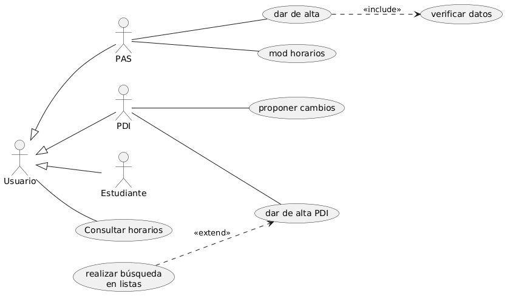
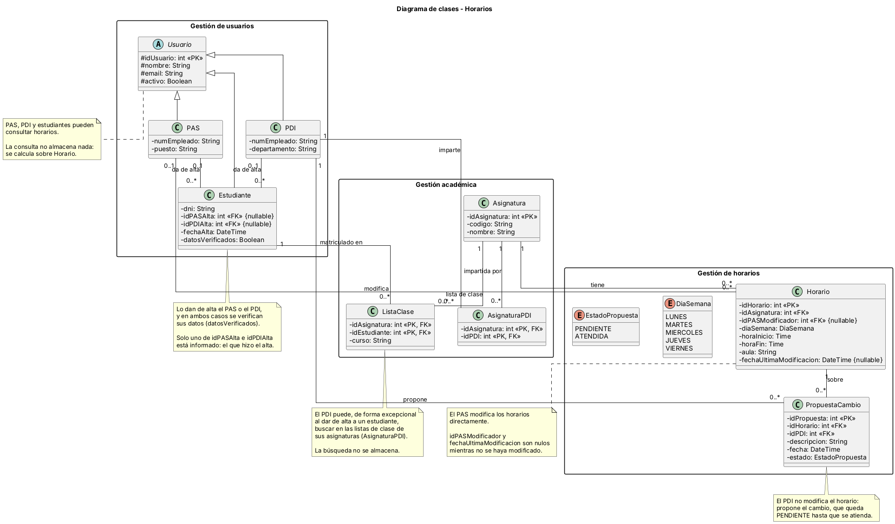
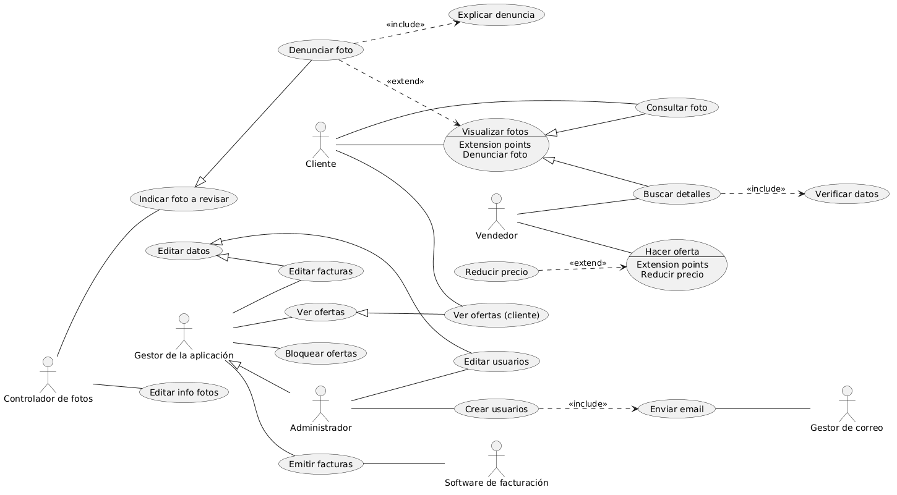
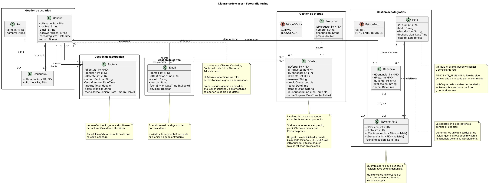

# Lab 1 — Ingeniería de Requisitos

Práctica de **casos de uso y requisitos de información** de la asignatura *Ingeniería de Requisitos* (Universidad de Almería), realizada por el grupo **INRE-UAL-Verde-2027**. Este documento reúne el contenido de los README de cada supuesto.

## Índice

| Supuesto | Tema | Autor |
|---|---|---|
| [Supuesto 1](#supuesto-1-horarios) | Horarios | Javier Zúñiga Carmona |
| [Supuesto 2](#supuesto-2-sistema-de-compras) | Sistema de Compras | Emilio Murillo Cortés |
| [Supuesto 3](#supuesto-3-compañía-hotelera) | Compañía hotelera | Marcos Sánchez García |
| [Supuesto 4](#supuesto-4-fotografía-online) | Fotografía Online | Javier Zúñiga Carmona |
| Supuesto 5 | Gestión de Incidencias | Pendiente |

## Equipo

| Integrante | Contacto |
|---|---|
| Fernando Sastre Guil | fsg399@inlumine.ual.es |
| Emilio Murillo Cortés | emc737@inlumine.ual.es |
| Marcos Sánchez García | msg802@inlumine.ual.es |
| Javier Zúñiga Carmona | javiizc05@gmail.com |

---

## Supuesto 1: Horarios

En una universidad, el personal del PDI, el personal del PAS y los estudiantes pueden consultar horarios. Por su parte, el personal del PAS puede modificar horarios y dar de alta estudiantes. El personal de PDI puede proponer cambios en los horarios y dar de alta estudiantes. La funcionalidad de dar de alta estudiantes del PAS realiza una verificación de los datos del estudiante. Sin embargo, la funcionalidad de dar de alta estudiantes del PDI, además de verificar los datos también permite de forma excepcional realizar la búsqueda en las listas de clase de sus asignaturas.

### Descripción de los actores

### Actores del sistema

#### Usuario

| **Actor** | **Usuario (ACT 001)** |
|---|---|
| **Desc** | Es el actor general que representa a cualquier persona que accede al sistema de horarios de la universidad. |
| **Caract** | Es un actor abstracto: sus características comunes las heredan el PAS, el PDI y el Estudiante. Puede consultar horarios. |
| **Relaciones** | Relación de herencia de PAS, PDI y Estudiante hacia Usuario. |
| **Referencias** | El usuario puede consultar horarios (UC-01), por lo que también lo pueden hacer el PAS, el PDI y el Estudiante. |
| **Autor** | Javier Zúñiga Carmona  \|  **Fecha:** 22/10/2026  \|  **Versión:** 1.0 |

#### PAS

| **Actor** | **PAS (ACT 002)** |
|---|---|
| **Desc** | Es el personal de administración y servicios de la universidad. |
| **Caract** | Además de consultar horarios, puede modificar horarios y dar de alta estudiantes, operación que conlleva una verificación de los datos del estudiante. |
| **Relaciones** | Relación de herencia del PAS hacia Usuario (ACT 001). |
| **Referencias** | El PAS puede modificar horarios (UC-02), dar de alta estudiantes (UC-03) y verificar datos (UC-04). Por herencia, puede consultar horarios (UC-01). |
| **Autor** | Javier Zúñiga Carmona  \|  **Fecha:** 22/10/2026  \|  **Versión:** 1.0 |

#### PDI

| **Actor** | **PDI (ACT 003)** |
|---|---|
| **Desc** | Es el personal docente e investigador de la universidad. |
| **Caract** | Además de consultar horarios, puede proponer cambios en los horarios y dar de alta estudiantes. De forma excepcional, al dar de alta estudiantes puede realizar la búsqueda en las listas de clase de sus asignaturas. |
| **Relaciones** | Relación de herencia del PDI hacia Usuario (ACT 001). |
| **Referencias** | El PDI puede proponer cambios (UC-05), dar de alta estudiantes (UC-06) y realizar búsquedas en listas de clase (UC-07). Por herencia, puede consultar horarios (UC-01). |
| **Autor** | Javier Zúñiga Carmona  \|  **Fecha:** 22/10/2026  \|  **Versión:** 1.0 |

#### Estudiante

| **Actor** | **Estudiante (ACT 004)** |
|---|---|
| **Desc** | Es el alumno matriculado en la universidad. |
| **Caract** | Solo puede consultar horarios. No tiene casos de uso propios. |
| **Relaciones** | Relación de herencia del Estudiante hacia Usuario (ACT 001). El PAS y el PDI son quienes lo dan de alta. |
| **Referencias** | El estudiante puede consultar horarios (UC-01), heredado de Usuario. |
| **Autor** | Javier Zúñiga Carmona  \|  **Fecha:** 22/10/2026  \|  **Versión:** 1.0 |

### Descripción de los casos de uso

### Casos de uso

#### UC-01 — Consultar horarios

| **Campo** | **Contenido** |
|---|---|
| **Nombre:** | Consultar horarios (UC-01) |
| **Autor:** | Javier Zúñiga Carmona |
| **Fecha:** | 22/10/2026 |
| **Descripción:** | Permite consultar los horarios de la universidad. Lo pueden realizar el PDI, el PAS y los estudiantes, por ser un caso de uso del actor general Usuario. |
| **Actores:** | Usuario (PAS, PDI y Estudiante, por herencia) |
| **Precondiciones:** | El actor debe estar identificado en el sistema. |
| **Flujo normal:** | 1. El actor accede a la sección de horarios. 2. El sistema muestra un formulario para seleccionar los criterios de consulta (asignatura, día, aula). 3. El actor introduce los criterios y confirma la consulta. 4. El sistema muestra los horarios que cumplen los criterios. |
| **Flujo alternativo:** | 4.A. Ningún horario cumple los criterios, por lo que el sistema muestra un mensaje indicándolo y el listado aparece vacío. |
| **Poscondiciones:** | Se muestran los horarios en pantalla, pero no se modifica ni se borra ningún dato en el sistema. |
| **Referencias:** | UC-02 (Modificar horarios) y UC-05 (Proponer cambios), que parten de los horarios consultados. |

#### UC-02 — Modificar horarios

| **Campo** | **Contenido** |
|---|---|
| **Nombre:** | Modificar horarios (UC-02) |
| **Autor:** | Javier Zúñiga Carmona |
| **Fecha:** | 22/10/2026 |
| **Descripción:** | Permite al personal del PAS modificar los horarios de las asignaturas. |
| **Actores:** | PAS |
| **Precondiciones:** | El PAS debe estar identificado en el sistema. El horario a modificar debe existir en el sistema. |
| **Flujo normal:** | 1. El PAS accede a la sección de horarios y selecciona el horario que desea modificar. 2. El sistema muestra los datos actuales del horario en un formulario editable. 3. El PAS modifica los datos (día, hora de inicio, hora de fin, aula) y confirma los cambios. 4. El sistema comprueba la validez de los datos, los almacena y registra el PAS y la fecha de la modificación. 5. El sistema muestra un mensaje confirmando que el horario ha sido modificado. |
| **Flujo alternativo:** | 3.A. El PAS cancela la modificación, de modo que el sistema descarta los cambios y no modifica el horario. 4.A. Los datos no son válidos, por lo que el sistema avisa al PAS de ello permitiéndole que los corrija. |
| **Poscondiciones:** | El horario ha sido modificado y almacenado en el sistema. |
| **Referencias:** | UC-01 (Consultar horarios), desde el que se localiza el horario. UC-05 (Proponer cambios), cuyas propuestas pueden dar lugar a la modificación. |

#### UC-03 — Dar de alta estudiantes PAS

| **Campo** | **Contenido** |
|---|---|
| **Nombre:** | Dar de alta estudiantes PAS (UC-03) |
| **Autor:** | Javier Zúñiga Carmona |
| **Fecha:** | 22/10/2026 |
| **Descripción:** | Permite al personal del PAS dar de alta a un estudiante en el sistema. El alta realiza una verificación de los datos del estudiante. |
| **Actores:** | PAS |
| **Precondiciones:** | El PAS debe estar identificado en el sistema. El estudiante no debe estar dado de alta previamente. |
| **Flujo normal:** | 1. El PAS accede a la gestión de estudiantes y selecciona la opción de dar de alta. 2. El sistema muestra un formulario para introducir los datos del estudiante. 3. El PAS introduce los datos y confirma el alta. 4. El sistema ejecuta el caso de uso Verificar datos (UC-04) sobre los datos introducidos. 5. El sistema almacena al estudiante, registrando el PAS y la fecha del alta. 6. El sistema muestra un mensaje confirmando que el estudiante ha sido dado de alta. |
| **Flujo alternativo:** | 3.A. El PAS cancela el alta, de modo que el sistema descarta los datos y no da de alta al estudiante. 4.A. Los datos no son válidos o el estudiante ya existe, por lo que el sistema avisa al PAS de ello permitiéndole que los corrija. |
| **Poscondiciones:** | El estudiante ha sido dado de alta y almacenado en el sistema con los datos verificados. |
| **Referencias:** | UC-04 (Verificar datos), que se incluye en este caso de uso. UC-06 (Dar de alta estudiantes PDI), caso equivalente del PDI. |

#### UC-04 — Verificar datos

| **Campo** | **Contenido** |
|---|---|
| **Nombre:** | Verificar datos (UC-04) |
| **Autor:** | Javier Zúñiga Carmona |
| **Fecha:** | 22/10/2026 |
| **Descripción:** | Permite comprobar que los datos del estudiante introducidos en el alta son correctos. Este caso de uso se ejecuta como parte de dar de alta estudiantes del PAS. |
| **Actores:** | PAS (a través de Dar de alta estudiantes PAS) |
| **Precondiciones:** | El PAS debe haber introducido los datos del estudiante en el alta (UC-03 en ejecución). |
| **Flujo normal:** | 1. El sistema recibe los datos introducidos del estudiante. 2. El sistema comprueba que los datos tienen el formato correcto, que los obligatorios están completos y que el DNI es válido. 3. El sistema da los datos por válidos y devuelve el control a Dar de alta estudiantes PAS. |
| **Flujo alternativo:** | 3.A. Los datos no son correctos, por lo que el sistema informa de los errores encontrados y los devuelve al PAS para que los corrija. |
| **Poscondiciones:** | Los datos han sido verificados, ya sea dándolos por válidos o notificando los errores. |
| **Referencias:** | UC-03 (Dar de alta estudiantes PAS), que lo incluye. |

#### UC-05 — Proponer cambios

| **Campo** | **Contenido** |
|---|---|
| **Nombre:** | Proponer cambios (UC-05) |
| **Autor:** | Javier Zúñiga Carmona |
| **Fecha:** | 22/10/2026 |
| **Descripción:** | Permite al personal del PDI proponer cambios en los horarios de las asignaturas. |
| **Actores:** | PDI |
| **Precondiciones:** | El PDI debe estar identificado en el sistema. El horario sobre el que se propone el cambio debe existir en el sistema. |
| **Flujo normal:** | 1. El PDI accede a la sección de horarios y selecciona el horario sobre el que quiere proponer un cambio. 2. El sistema muestra el horario y un formulario para describir el cambio propuesto. 3. El PDI describe el cambio y confirma la propuesta. 4. El sistema registra la propuesta como pendiente, con el PDI y la fecha. 5. El sistema muestra un mensaje confirmando que la propuesta ha sido registrada. |
| **Flujo alternativo:** | 3.A. El PDI cancela la propuesta, de modo que el sistema descarta los datos y no registra ninguna propuesta. 4.A. La descripción está vacía, por lo que el sistema avisa al PDI de que debe introducirla. |
| **Poscondiciones:** | La propuesta de cambio ha sido registrada como pendiente en el sistema. |
| **Referencias:** | UC-01 (Consultar horarios), desde el que se localiza el horario. UC-02 (Modificar horarios), que puede aplicar el cambio propuesto. |

#### UC-06 — Dar de alta estudiantes PDI

| **Campo** | **Contenido** |
|---|---|
| **Nombre:** | Dar de alta estudiantes PDI (UC-06) |
| **Autor:** | Javier Zúñiga Carmona |
| **Fecha:** | 22/10/2026 |
| **Descripción:** | Permite al personal del PDI dar de alta a un estudiante en el sistema, verificando los datos introducidos. De forma excepcional, durante el alta se pueden buscar estudiantes en las listas de clase de sus asignaturas (punto de extensión: Realizar búsqueda en listas). |
| **Actores:** | PDI |
| **Precondiciones:** | El PDI debe estar identificado en el sistema. El estudiante no debe estar dado de alta previamente. |
| **Flujo normal:** | 1. El PDI accede a la gestión de estudiantes y selecciona la opción de dar de alta. 2. El sistema muestra un formulario para introducir los datos del estudiante. 3. El PDI introduce los datos y confirma el alta. 4. El sistema verifica los datos introducidos. 5. El sistema almacena al estudiante, registrando el PDI y la fecha del alta. 6. El sistema muestra un mensaje confirmando que el estudiante ha sido dado de alta. |
| **Flujo alternativo:** | 3.A. El PDI necesita buscar al estudiante en las listas de clase de sus asignaturas. Se ejecuta el caso de uso Realizar búsqueda en listas (UC-07) a través del punto de extensión. 3.B. El PDI cancela el alta, de modo que el sistema descarta los datos y no da de alta al estudiante. 4.A. Los datos no son válidos o el estudiante ya existe, por lo que el sistema avisa al PDI de ello permitiéndole que los corrija. |
| **Poscondiciones:** | El estudiante ha sido dado de alta y almacenado en el sistema con los datos verificados. |
| **Referencias:** | UC-07 (Realizar búsqueda en listas), que lo extiende. UC-03 (Dar de alta estudiantes PAS), caso equivalente del PAS. |

#### UC-07 — Realizar búsqueda en listas

| **Campo** | **Contenido** |
|---|---|
| **Nombre:** | Realizar búsqueda en listas (UC-07) |
| **Autor:** | Javier Zúñiga Carmona |
| **Fecha:** | 22/10/2026 |
| **Descripción:** | Permite al PDI buscar estudiantes en las listas de clase de las asignaturas que imparte. Se ejecuta solo de forma excepcional, como extensión de dar de alta estudiantes del PDI. |
| **Actores:** | PDI |
| **Precondiciones:** | El PDI debe estar dando de alta a un estudiante (UC-06 en ejecución) y debe impartir al menos una asignatura. |
| **Flujo normal:** | 1. El PDI selecciona la opción de buscar en las listas de clase durante el alta. 2. El sistema muestra las asignaturas que imparte el PDI y un campo de búsqueda. 3. El PDI selecciona una asignatura e introduce el criterio de búsqueda (nombre o DNI). 4. El sistema muestra los estudiantes de la lista de clase que cumplen el criterio. 5. El sistema devuelve el control a Dar de alta estudiantes PDI (UC-06). |
| **Flujo alternativo:** | 3.A. El PDI cancela la búsqueda y el sistema devuelve el control al alta sin cambios. 4.A. Ningún estudiante cumple el criterio, por lo que el sistema muestra un mensaje indicándolo. |
| **Poscondiciones:** | Se muestran los estudiantes encontrados en pantalla, pero no se modifica ni se borra ningún dato en el sistema. |
| **Referencias:** | UC-06 (Dar de alta estudiantes PDI), al que extiende. |

### Base de datos

### Tablas de Requisitos de información

#### INF-001 — USUARIO

| **Campo** | **Contenido** |
|---|---|
| **Código** | INF-001 |
| **Nombre** | USUARIO |
| **Versión** | 1.0 (Octubre-2026) |
| **Autores** | Javier Zúñiga Carmona |
| **Fuentes** | Enunciado del supuesto 1 (Horarios) |
| **Referencias** | UC-01 Consultar horarios. UC-03 Dar de alta estudiantes PAS. UC-06 Dar de alta estudiantes PDI. |
| **Descripción** | El sistema deberá almacenar la información correspondiente a los usuarios de la universidad (PAS, PDI y estudiantes). |
| **Datos específicos** | - Identificador de usuario - Nombre - Correo electrónico - Si el usuario está activo - Tipo de usuario (PAS, PDI o estudiante) |
| **Importancia** | Muy importante |
| **Estado** | Aceptado |
| **Comentarios** | Los datos propios de cada tipo de usuario se recogen en INF-002, INF-003 e INF-004. |

#### INF-002 — PAS

| **Campo** | **Contenido** |
|---|---|
| **Código** | INF-002 |
| **Nombre** | PAS |
| **Versión** | 1.0 (Octubre-2026) |
| **Autores** | Javier Zúñiga Carmona |
| **Fuentes** | Enunciado del supuesto 1 (Horarios) |
| **Referencias** | UC-02 Modificar horarios. UC-03 Dar de alta estudiantes PAS. INF-001 USUARIO. |
| **Descripción** | El sistema deberá almacenar la información correspondiente al personal de administración y servicios. |
| **Datos específicos** | - Número de empleado - Puesto |
| **Importancia** | Importante |
| **Estado** | Aceptado |
| **Comentarios** | Hereda los datos del usuario (INF-001). |

#### INF-003 — PDI

| **Campo** | **Contenido** |
|---|---|
| **Código** | INF-003 |
| **Nombre** | PDI |
| **Versión** | 1.0 (Octubre-2026) |
| **Autores** | Javier Zúñiga Carmona |
| **Fuentes** | Enunciado del supuesto 1 (Horarios) |
| **Referencias** | UC-05 Proponer cambios. UC-06 Dar de alta estudiantes PDI. UC-07 Realizar búsqueda en listas. INF-001 USUARIO. |
| **Descripción** | El sistema deberá almacenar la información correspondiente al personal docente e investigador. |
| **Datos específicos** | - Número de empleado - Departamento - Asignaturas que imparte |
| **Importancia** | Importante |
| **Estado** | Aceptado |
| **Comentarios** | Hereda los datos del usuario (INF-001). Las asignaturas que imparte determinan en qué listas de clase puede buscar. |

#### INF-004 — ESTUDIANTE

| **Campo** | **Contenido** |
|---|---|
| **Código** | INF-004 |
| **Nombre** | ESTUDIANTE |
| **Versión** | 1.0 (Octubre-2026) |
| **Autores** | Javier Zúñiga Carmona |
| **Fuentes** | Enunciado del supuesto 1 (Horarios) |
| **Referencias** | UC-03 Dar de alta estudiantes PAS. UC-04 Verificar datos. UC-06 Dar de alta estudiantes PDI. UC-07 Realizar búsqueda en listas. INF-001 USUARIO. |
| **Descripción** | El sistema deberá almacenar la información correspondiente a los estudiantes de la universidad. |
| **Datos específicos** | - DNI - Fecha de alta - Si sus datos han sido verificados - Personal que lo ha dado de alta (PAS o PDI) |
| **Importancia** | Muy importante |
| **Estado** | Aceptado |
| **Comentarios** | Hereda los datos del usuario (INF-001). Un estudiante es dado de alta por un PAS o por un PDI, nunca por ambos. |

#### INF-005 — ASIGNATURA

| **Campo** | **Contenido** |
|---|---|
| **Código** | INF-005 |
| **Nombre** | ASIGNATURA |
| **Versión** | 1.0 (Octubre-2026) |
| **Autores** | Javier Zúñiga Carmona |
| **Fuentes** | Enunciado del supuesto 1 (Horarios) |
| **Referencias** | UC-01 Consultar horarios. UC-05 Proponer cambios. UC-07 Realizar búsqueda en listas. INF-003 PDI. |
| **Descripción** | El sistema deberá almacenar la información correspondiente a las asignaturas de la universidad. |
| **Datos específicos** | - Identificador de la asignatura - Código - Nombre - PDI que la imparte |
| **Importancia** | Importante |
| **Estado** | Aceptado |
| **Comentarios** | Una asignatura puede ser impartida por varios PDI y un PDI puede impartir varias asignaturas. |

#### INF-006 — LISTA_DE_CLASE

| **Campo** | **Contenido** |
|---|---|
| **Código** | INF-006 |
| **Nombre** | LISTA_DE_CLASE |
| **Versión** | 1.0 (Octubre-2026) |
| **Autores** | Javier Zúñiga Carmona |
| **Fuentes** | Enunciado del supuesto 1 (Horarios) |
| **Referencias** | UC-07 Realizar búsqueda en listas. INF-005 ASIGNATURA. INF-004 ESTUDIANTE. |
| **Descripción** | El sistema deberá almacenar la información correspondiente a las listas de clase, que relacionan a los estudiantes con las asignaturas en las que están matriculados. |
| **Datos específicos** | - Asignatura - Estudiante - Curso académico |
| **Importancia** | Importante |
| **Estado** | Aceptado |
| **Comentarios** | Es la información sobre la que el PDI realiza la búsqueda de estudiantes. |

#### INF-007 — HORARIO

| **Campo** | **Contenido** |
|---|---|
| **Código** | INF-007 |
| **Nombre** | HORARIO |
| **Versión** | 1.0 (Octubre-2026) |
| **Autores** | Javier Zúñiga Carmona |
| **Fuentes** | Enunciado del supuesto 1 (Horarios) |
| **Referencias** | UC-01 Consultar horarios. UC-02 Modificar horarios. UC-05 Proponer cambios. INF-005 ASIGNATURA. INF-002 PAS. |
| **Descripción** | El sistema deberá almacenar la información correspondiente a los horarios de las asignaturas. |
| **Datos específicos** | - Identificador del horario - Asignatura - Día de la semana - Hora de inicio - Hora de fin - Aula - PAS que lo modificó por última vez y fecha de la modificación (solo si se ha modificado) |
| **Importancia** | Muy importante |
| **Estado** | Aceptado |
| **Comentarios** | Solo el PAS puede modificar un horario; el PDI únicamente propone cambios. |

#### INF-008 — PROPUESTA_DE_CAMBIO

| **Campo** | **Contenido** |
|---|---|
| **Código** | INF-008 |
| **Nombre** | PROPUESTA_DE_CAMBIO |
| **Versión** | 1.0 (Octubre-2026) |
| **Autores** | Javier Zúñiga Carmona |
| **Fuentes** | Enunciado del supuesto 1 (Horarios) |
| **Referencias** | UC-05 Proponer cambios. INF-007 HORARIO. INF-003 PDI. |
| **Descripción** | El sistema deberá almacenar la información correspondiente a las propuestas de cambio de horario que realiza el PDI. |
| **Datos específicos** | - Identificador de la propuesta - Horario sobre el que se propone el cambio - PDI que la propone - Descripción del cambio - Fecha de la propuesta - Estado (pendiente o atendida) |
| **Importancia** | Importante |
| **Estado** | Aceptado |
| **Comentarios** | Una propuesta nace pendiente y pasa a atendida cuando el PAS la revisa. |

## Supuesto 2: Sistema de Compras

En un sistema de compra, existen cuatro tipos de usuarios: comprador, vendedor, proveedor y administrador. Los compradores pueden agregar productos, consultar precios, finalizar la compra y consultar ofertas. Agregar productos implica marcar esos productos como bloqueados. Los vendedores también pueden consultar ofertas y consultar precios. Los proveedores pueden consultar precios, avisar de nuevos productos y consultar ofertas. Avisar de nuevos productos, de forma excepcional, realiza la incorporación de una oferta. Los proveedores también tienen una funcionalidad para avisar del fin de una oferta. Cuando se avisa del fin de una oferta, se ejecuta la funcionalidad de eliminar la oferta. Ambas funcionalidades de avisar del proveedor tienen en común que se encarga de enviar una notificación. Los administradores pueden consultar precios, consultar ofertas y eliminar productos. La funcionalidad de consultar precios incluye una funcionalidad de buscar productos que es similar a la funcionalidad de consultar productos de los compradores. Sin embargo, la funcionalidad de consultar productos añade una funcionalidad para verificar la disponibilidad. Para realizar una venta, un comprador y un vendedor participan de forma conjunta. En dicha operación, se lleva a cabo el acuerdo de un precio; excepcionalmente, durante la realización de la venta, se consultará el histórico de ventas.

### Descripción de los actores

### Actores del sistema

#### Usuario

| **Actor** | **Usuario (ACT 001)** |
|---|---|
| **Desc** | Es el actor general que representa a cualquier persona que accede al sistema de compras. |
| **Caract** | Es un actor abstracto: sus características comunes las heredan el Comprador, el Vendedor, el Proveedor y el Administrador. Puede consultar precios y consultar ofertas. |
| **Relaciones** | Relación de herencia de Comprador, Vendedor, Proveedor y Administrador hacia Usuario. |
| **Referencias** | El usuario puede consultar precios (UC-01) y consultar ofertas (UC-02), por lo que también pueden hacerlo el Comprador, el Vendedor, el Proveedor y el Administrador. |
| **Autor** | Emilio Murillo Cortés \| **Fecha:** 24/10/2026 \| **Versión:** 1.0 |

#### Comprador

| **Actor** | **Comprador (ACT 002)** |
|---|---|
| **Desc** | Representa a la persona que utiliza el sistema para seleccionar productos y efectuar una compra. |
| **Caract** | Es una especialización de Usuario. Puede consultar precios y ofertas, agregar productos, consultar productos y participar en la realización de una compraventa. |
| **Relaciones** | Hereda del actor Usuario. Se relaciona con Agregar productos, Consultar productos y Realizar compraventa. En la compraventa participa conjuntamente con el Vendedor. |
| **Referencias** | Puede consultar precios (UC-01), consultar ofertas (UC-02), agregar productos (UC-03), consultar productos (UC-05) y realizar una compraventa (UC-07). Agregar productos incluye marcar los productos como bloqueados (UC-04). Consultar productos incluye verificar su disponibilidad (UC-06). Realizar la compraventa incluye acordar el precio (UC-08) y puede extenderse excepcionalmente con la consulta del histórico de ventas (UC-09). |
| **Autor** | Emilio Murillo Cortés \| **Fecha:** 24/10/2026 \| **Versión:** 1.0 |

#### Vendedor

| **Actor** | **Vendedor (ACT 003)** |
|---|---|
| **Desc** | Representa a la persona que interviene en la venta de productos dentro del sistema de compras. |
| **Caract** | Es una especialización de Usuario. Puede consultar precios y ofertas, además de participar en la realización de una compraventa. |
| **Relaciones** | Hereda del actor Usuario. Se relaciona directamente con Realizar compraventa, operación en la que participa conjuntamente con el Comprador. |
| **Referencias** | Puede consultar precios (UC-01), consultar ofertas (UC-02) y realizar una compraventa (UC-07). La compraventa incluye acordar el precio (UC-08) y puede extenderse excepcionalmente con la consulta del histórico de ventas (UC-09). |
| **Autor** | Emilio Murillo Cortés \| **Fecha:** 24/10/2026 \| **Versión:** 1.0 |

#### Proveedor

| **Actor** | **Proveedor (ACT 004)** |
|---|---|
| **Desc** | Representa a la persona o entidad que suministra productos y comunica al sistema la aparición o finalización de ofertas. |
| **Caract** | Es una especialización de Usuario. Puede consultar precios y ofertas, avisar de nuevos productos y avisar del fin de una oferta. |
| **Relaciones** | Hereda del actor Usuario. Se relaciona con Avisar de nuevos productos y Avisar del fin de una oferta. Ambas funcionalidades son especializaciones de Avisar. |
| **Referencias** | Puede consultar precios (UC-01), consultar ofertas (UC-02), avisar de nuevos productos (UC-10) y avisar del fin de una oferta (UC-14). Avisar de nuevos productos puede provocar excepcionalmente la incorporación de una oferta (UC-11). Avisar del fin de una oferta incluye eliminar la oferta (UC-15). Las dos modalidades de aviso comparten la funcionalidad Avisar (UC-12), que incluye enviar una notificación (UC-13). |
| **Autor** | Emilio Murillo Cortés \| **Fecha:** 24/10/2026 \| **Versión:** 1.0 |

#### Administrador

| **Actor** | **Administrador (ACT 005)** |
|---|---|
| **Desc** | Representa a la persona responsable de gestionar y eliminar productos dentro del sistema de compras. |
| **Caract** | Es una especialización de Usuario. Puede consultar precios y ofertas, además de eliminar productos. |
| **Relaciones** | Hereda del actor Usuario. Se relaciona directamente con Eliminar productos. |
| **Referencias** | Puede consultar precios (UC-01), consultar ofertas (UC-02) y eliminar productos (UC-16). La consulta de precios incluye la búsqueda de productos (UC-17). |
| **Autor** | Emilio Murillo Cortés \| **Fecha:** 24/10/2026 \| **Versión:** 1.0 |

### Descripción de los casos de uso

### Casos de uso

#### UC-01 — Consultar precios

| **Campo** | **Contenido** |
|---|---|
| **Nombre:** | Consultar precios (UC-01) |
| **Autor:** | Emilio Murillo Cortés |
| **Fecha:** | 24/10/2026 |
| **Descripción:** | Permite consultar el precio de los productos del sistema. |
| **Actores:** | Usuario. |
| **Precondiciones:** |  |
| **Flujo normal:** | 1. El usuario introduce los criterios de búsqueda. 2. El sistema busca los productos que coinciden con los criterios. 3. El sistema muestra los productos encontrados. 4. El sistema muestra el precio de cada producto. |
| **Flujo alternativo:** |  |
| **Poscondiciones:** |  |

#### UC-02 — Consultar ofertas

| **Campo** | **Contenido** |
|---|---|
| **Nombre:** | Consultar ofertas (UC-02) |
| **Autor:** | Emilio Murillo Cortés |
| **Fecha:** | 24/10/2026 |
| **Descripción:** | Permite consultar las ofertas existentes en el sistema. |
| **Actores:** | Usuario. |
| **Precondiciones:** |  |
| **Flujo normal:** | 1. El usuario solicita consultar las ofertas. 2. El sistema obtiene las ofertas existentes. 3. El sistema muestra las ofertas al usuario. |
| **Flujo alternativo:** |  |
| **Poscondiciones:** |  |

#### UC-03 — Agregar productos

| **Campo** | **Contenido** |
|---|---|
| **Nombre:** | Agregar productos (UC-03) |
| **Autor:** | Emilio Murillo Cortés |
| **Fecha:** | 24/10/2026 |
| **Descripción:** | Permite al comprador agregar productos al carrito. |
| **Actores:** | Comprador. |
| **Precondiciones:** | El producto debe estar disponible. |
| **Flujo normal:** | 1. El comprador selecciona un producto. 2. El comprador indica la cantidad deseada. 3. El sistema identifica el producto seleccionado. 4. El sistema reserva la cantidad seleccionada. 5. El sistema reduce la cantidad disponible del producto. 6. Si la cantidad disponible llega a cero, el sistema marca el producto como BLOQUEADO. 7. El sistema agrega el producto al carrito. 8. El sistema confirma que el producto ha sido agregado. |
| **Flujo alternativo:** |  |
| **Poscondiciones:** | El producto queda agregado al carrito y se reduce su cantidad disponible. Si no quedan unidades disponibles, el producto queda en estado BLOQUEADO. |

#### UC-04 — Marcar productos como bloqueados

| **Campo** | **Contenido** |
|---|---|
| **Nombre:** | Marcar productos como bloqueados (UC-04) |
| **Autor:** | Emilio Murillo Cortés |
| **Fecha:** | 24/10/2026 |
| **Descripción:** | Permite reservar las unidades de un producto y bloquearlo cuando se agotan sus existencias. |
| **Actores:** | Comprador. |
| **Precondiciones:** | El producto debe estar disponible. |
| **Flujo normal:** | 1. El sistema identifica el producto seleccionado. 2. El sistema reserva la cantidad seleccionada. 3. El sistema reduce la cantidad disponible del producto. 4. Si la cantidad disponible llega a cero, el sistema marca el producto como BLOQUEADO. |
| **Flujo alternativo:** |  |
| **Poscondiciones:** | Se reduce la cantidad disponible del producto. Si no quedan unidades disponibles, el producto queda en estado BLOQUEADO. |

#### UC-05 — Consultar productos

| **Campo** | **Contenido** |
|---|---|
| **Nombre:** | Consultar productos (UC-05) |
| **Autor:** | Emilio Murillo Cortés |
| **Fecha:** | 24/10/2026 |
| **Descripción:** | Permite al comprador consultar los productos del sistema y conocer su disponibilidad. |
| **Actores:** | Comprador. |
| **Precondiciones:** |  |
| **Flujo normal:** | 1. El comprador solicita consultar los productos. 2. El sistema obtiene los productos existentes. 3. El sistema consulta el estado de cada producto. 4. El sistema consulta la cantidad disponible de cada producto. 5. El sistema determina que un producto está disponible si se encuentra ACTIVO y su cantidad disponible es mayor que cero. 6. El sistema muestra el resultado al comprador. 7. El sistema muestra la información de los productos. |
| **Flujo alternativo:** |  |
| **Poscondiciones:** |  |

#### UC-06 — Verificar disponibilidad

| **Campo** | **Contenido** |
|---|---|
| **Nombre:** | Verificar disponibilidad (UC-06) |
| **Autor:** | Emilio Murillo Cortés |
| **Fecha:** | 24/10/2026 |
| **Descripción:** | Permite comprobar si un producto está disponible para su compra. |
| **Actores:** | Comprador. |
| **Precondiciones:** | El producto debe existir. |
| **Flujo normal:** | 1. El sistema consulta el estado de cada producto. 2. El sistema consulta la cantidad disponible de cada producto. 3. El sistema determina que un producto está disponible si se encuentra ACTIVO y su cantidad disponible es mayor que cero. 4. El sistema muestra el resultado al comprador. |
| **Flujo alternativo:** |  |
| **Poscondiciones:** |  |

#### UC-07 — Realizar compraventa

| **Campo** | **Contenido** |
|---|---|
| **Nombre:** | Realizar compraventa (UC-07) |
| **Autor:** | Emilio Murillo Cortés |
| **Fecha:** | 24/10/2026 |
| **Descripción:** | Permite realizar una compraventa entre un comprador y un vendedor. |
| **Actores:** | Comprador y Vendedor. |
| **Precondiciones:** | El comprador debe haber seleccionado al menos un producto. |
| **Flujo normal:** | 1. El comprador solicita realizar la compraventa. 2. El sistema muestra los productos incluidos en la operación. 3. El sistema presenta el precio de cada producto. 4. El comprador y el vendedor acuerdan el precio definitivo. 5. El sistema conserva el precio acordado para la compraventa. 6. El sistema calcula el importe total. 7. El sistema registra la compraventa y sus productos. 8. El sistema confirma la realización de la compraventa. |
| **Flujo alternativo:** | 4.A. Durante la realización de la compraventa se solicita consultar el histórico de ventas. 4.A.1. El sistema obtiene las compraventas anteriores. 4.A.2. El sistema muestra la información de las ventas anteriores. 4.A.3. La compraventa continúa en el paso 4. |
| **Poscondiciones:** | La compraventa, sus productos y los precios definitivos quedan registrados en el sistema. |

#### UC-08 — Acordar precio

| **Campo** | **Contenido** |
|---|---|
| **Nombre:** | Acordar precio (UC-08) |
| **Autor:** | Emilio Murillo Cortés |
| **Fecha:** | 24/10/2026 |
| **Descripción:** | Permite establecer el precio definitivo de los productos de una compraventa. |
| **Actores:** | Comprador y Vendedor. |
| **Precondiciones:** | Debe estar realizándose una compraventa. |
| **Flujo normal:** | 1. El sistema presenta el precio de cada producto. 2. El comprador y el vendedor acuerdan el precio definitivo. 3. El sistema conserva el precio acordado para la compraventa. |
| **Flujo alternativo:** |  |
| **Poscondiciones:** | El precio definitivo queda establecido para la compraventa. |

#### UC-09 — Consultar histórico de ventas

| **Campo** | **Contenido** |
|---|---|
| **Nombre:** | Consultar histórico de ventas (UC-09) |
| **Autor:** | Emilio Murillo Cortés |
| **Fecha:** | 24/10/2026 |
| **Descripción:** | Permite consultar las compraventas realizadas anteriormente. |
| **Actores:** | Comprador y Vendedor. |
| **Precondiciones:** | Debe estar realizándose una compraventa. |
| **Flujo normal:** | 1. El actor solicita consultar el histórico de ventas. 2. El sistema obtiene las compraventas anteriores. 3. El sistema muestra la información de las ventas anteriores. |
| **Flujo alternativo:** |  |
| **Poscondiciones:** |  |

#### UC-10 — Avisar de nuevos productos

| **Campo** | **Contenido** |
|---|---|
| **Nombre:** | Avisar de nuevos productos (UC-10) |
| **Autor:** | Emilio Murillo Cortés |
| **Fecha:** | 24/10/2026 |
| **Descripción:** | Permite al proveedor avisar de la existencia de nuevos productos. |
| **Actores:** | Proveedor. |
| **Precondiciones:** | El producto debe existir en el sistema. |
| **Flujo normal:** | 1. El proveedor selecciona el nuevo producto. 2. El proveedor introduce la información del aviso. 3. El sistema identifica al destinatario. 4. El sistema genera el título y el mensaje. 5. El sistema relaciona la notificación con el producto correspondiente. 6. El sistema registra la notificación como no leída. 7. El sistema pone la notificación a disposición del destinatario. 8. El sistema confirma la realización del aviso. |
| **Flujo alternativo:** | 2.A. El nuevo producto dispone de una oferta. 2.A.1. El proveedor introduce el precio y las fechas de la oferta. 2.A.2. El sistema asocia la oferta al producto. 2.A.3. El sistema registra la oferta. 2.A.4. El sistema confirma que la oferta ha sido incorporada. 2.A.5. El proceso continúa en el paso 3. |
| **Poscondiciones:** | La notificación queda registrada. Si se incorpora una oferta, la oferta también queda registrada. |

#### UC-11 — Incorporar oferta

| **Campo** | **Contenido** |
|---|---|
| **Nombre:** | Incorporar oferta (UC-11) |
| **Autor:** | Emilio Murillo Cortés |
| **Fecha:** | 24/10/2026 |
| **Descripción:** | Permite incorporar una oferta asociada a un nuevo producto. |
| **Actores:** | Proveedor. |
| **Precondiciones:** | El producto debe existir en el sistema. |
| **Flujo normal:** | 1. El proveedor introduce el precio y las fechas de la oferta. 2. El sistema asocia la oferta al producto. 3. El sistema registra la oferta. 4. El sistema confirma que la oferta ha sido incorporada. |
| **Flujo alternativo:** |  |
| **Poscondiciones:** | La oferta queda registrada y asociada al producto. |

#### UC-12 — Avisar

| **Campo** | **Contenido** |
|---|---|
| **Nombre:** | Avisar (UC-12) |
| **Autor:** | Emilio Murillo Cortés |
| **Fecha:** | 24/10/2026 |
| **Descripción:** | Recoge el comportamiento común de los avisos realizados por el proveedor. |
| **Actores:** | Proveedor. |
| **Precondiciones:** |  |
| **Flujo normal:** | 1. El proveedor introduce la información del aviso. 2. El sistema identifica el producto o la oferta relacionados. 3. El sistema identifica al destinatario. 4. El sistema genera el título y el mensaje. 5. El sistema relaciona la notificación con el producto o la oferta correspondiente. 6. El sistema registra la notificación como no leída. 7. El sistema pone la notificación a disposición del destinatario. 8. El sistema confirma la realización del aviso. |
| **Flujo alternativo:** |  |
| **Poscondiciones:** | La notificación del aviso queda registrada en el sistema. |

#### UC-13 — Enviar notificación

| **Campo** | **Contenido** |
|---|---|
| **Nombre:** | Enviar notificación (UC-13) |
| **Autor:** | Emilio Murillo Cortés |
| **Fecha:** | 24/10/2026 |
| **Descripción:** | Permite enviar una notificación a un usuario del sistema. |
| **Actores:** | Proveedor. |
| **Precondiciones:** | Debe existir un destinatario para la notificación. |
| **Flujo normal:** | 1. El sistema identifica al destinatario. 2. El sistema genera el título y el mensaje. 3. El sistema relaciona la notificación con el producto o la oferta correspondiente. 4. El sistema registra la notificación como no leída. 5. El sistema pone la notificación a disposición del destinatario. |
| **Flujo alternativo:** |  |
| **Poscondiciones:** | La notificación queda registrada como no leída. |

#### UC-14 — Avisar del fin de una oferta

| **Campo** | **Contenido** |
|---|---|
| **Nombre:** | Avisar del fin de una oferta (UC-14) |
| **Autor:** | Emilio Murillo Cortés |
| **Fecha:** | 24/10/2026 |
| **Descripción:** | Permite al proveedor avisar de que una oferta ha finalizado. |
| **Actores:** | Proveedor. |
| **Precondiciones:** | La oferta debe existir. |
| **Flujo normal:** | 1. El proveedor selecciona la oferta finalizada. 2. El sistema identifica la oferta. 3. El sistema cambia su estado a ELIMINADA. 4. El sistema confirma la eliminación de la oferta. 5. El proveedor introduce la información del aviso. 6. El sistema identifica al destinatario. 7. El sistema genera el título y el mensaje. 8. El sistema relaciona la notificación con la oferta correspondiente. 9. El sistema registra la notificación como no leída. 10. El sistema pone la notificación a disposición del destinatario. 11. El sistema confirma la realización del aviso. |
| **Flujo alternativo:** |  |
| **Poscondiciones:** | La oferta queda registrada con estado ELIMINADA y la notificación queda registrada como no leída. |

#### UC-15 — Eliminar oferta

| **Campo** | **Contenido** |
|---|---|
| **Nombre:** | Eliminar oferta (UC-15) |
| **Autor:** | Emilio Murillo Cortés |
| **Fecha:** | 24/10/2026 |
| **Descripción:** | Permite eliminar una oferta que ha llegado a su fin. |
| **Actores:** | Proveedor. |
| **Precondiciones:** | La oferta debe existir. |
| **Flujo normal:** | 1. El sistema identifica la oferta. 2. El sistema cambia su estado a ELIMINADA. 3. El sistema confirma la eliminación de la oferta. |
| **Flujo alternativo:** |  |
| **Poscondiciones:** | La oferta queda registrada con estado ELIMINADA. |

#### UC-16 — Eliminar productos

| **Campo** | **Contenido** |
|---|---|
| **Nombre:** | Eliminar productos (UC-16) |
| **Autor:** | Emilio Murillo Cortés |
| **Fecha:** | 24/10/2026 |
| **Descripción:** | Permite al administrador eliminar productos del sistema. |
| **Actores:** | Administrador. |
| **Precondiciones:** | El producto debe existir. |
| **Flujo normal:** | 1. El administrador selecciona el producto. 2. El sistema muestra la información del producto. 3. El administrador confirma la eliminación. 4. El sistema cambia el estado del producto a ELIMINADO. 5. El sistema confirma la eliminación. |
| **Flujo alternativo:** |  |
| **Poscondiciones:** | El producto queda registrado con estado ELIMINADO. |

#### UC-17 — Buscar productos

| **Campo** | **Contenido** |
|---|---|
| **Nombre:** | Buscar productos (UC-17) |
| **Autor:** | Emilio Murillo Cortés |
| **Fecha:** | 24/10/2026 |
| **Descripción:** | Permite buscar productos en el sistema. |
| **Actores:** | Usuario. |
| **Precondiciones:** |  |
| **Flujo normal:** | 1. El usuario introduce los criterios de búsqueda. 2. El sistema busca los productos que coinciden con los criterios. 3. El sistema muestra los productos encontrados. |
| **Flujo alternativo:** |  |
| **Poscondiciones:** |  |

### Base de datos

### Tablas de Requisitos de información

#### INF-001 — USUARIO

| **Campo** | **Contenido** |
|---|---|
| **Código** | INF-001 |
| **Nombre** | USUARIO |
| **Versión** | 1.0 (Octubre-2026) |
| **Autores** | Emilio Murillo Cortés |
| **Fuentes** | Enunciado del supuesto 2 (Sistema de Compras) |
| **Referencias** | UC-01 Consultar precios. UC-02 Consultar ofertas. UC-03 Agregar productos. UC-07 Realizar compraventa. UC-10 Avisar de nuevos productos. UC-14 Avisar del fin de una oferta. UC-16 Eliminar productos. |
| **Descripción** | El sistema deberá almacenar la información correspondiente a los usuarios del sistema de compras. |
| **Datos específicos** | - Identificador del usuario - Nombre - Correo electrónico - Contraseña - Fecha de registro - Estado de actividad |
| **Importancia** | Muy importante |
| **Estado** | Aceptado |
| **Comentarios** | Un usuario puede tener asignados uno o varios roles. |

#### INF-002 — ROL

| **Campo** | **Contenido** |
|---|---|
| **Código** | INF-002 |
| **Nombre** | ROL |
| **Versión** | 1.0 (Octubre-2026) |
| **Autores** | Emilio Murillo Cortés |
| **Fuentes** | Enunciado del supuesto 2 (Sistema de Compras) |
| **Referencias** | ACT-002 Comprador. ACT-003 Vendedor. ACT-004 Proveedor. ACT-005 Administrador. |
| **Descripción** | El sistema deberá almacenar los diferentes roles que pueden asignarse a los usuarios. |
| **Datos específicos** | - Identificador del rol - Nombre |
| **Importancia** | Muy importante |
| **Estado** | Aceptado |
| **Comentarios** | Los roles del sistema son Comprador, Vendedor, Proveedor y Administrador. |

#### INF-003 — USUARIO_ROL

| **Campo** | **Contenido** |
|---|---|
| **Código** | INF-003 |
| **Nombre** | USUARIO_ROL |
| **Versión** | 1.0 (Octubre-2026) |
| **Autores** | Emilio Murillo Cortés |
| **Fuentes** | Enunciado del supuesto 2 (Sistema de Compras) |
| **Referencias** | ACT-002 Comprador. ACT-003 Vendedor. ACT-004 Proveedor. ACT-005 Administrador. |
| **Descripción** | El sistema deberá almacenar la relación entre los usuarios y los roles que tienen asignados. |
| **Datos específicos** | - Identificador del usuario - Identificador del rol |
| **Importancia** | Muy importante |
| **Estado** | Aceptado |
| **Comentarios** | Un usuario puede tener varios roles y un mismo rol puede estar asignado a varios usuarios. |

#### INF-004 — PRODUCTO

| **Campo** | **Contenido** |
|---|---|
| **Código** | INF-004 |
| **Nombre** | PRODUCTO |
| **Versión** | 1.0 (Octubre-2026) |
| **Autores** | Emilio Murillo Cortés |
| **Fuentes** | Enunciado del supuesto 2 (Sistema de Compras) |
| **Referencias** | UC-01 Consultar precios. UC-03 Agregar productos. UC-04 Marcar productos como bloqueados. UC-05 Consultar productos. UC-06 Verificar disponibilidad. UC-10 Avisar de nuevos productos. UC-16 Eliminar productos. UC-17 Buscar productos. |
| **Descripción** | El sistema deberá almacenar la información correspondiente a los productos ofrecidos por los vendedores. |
| **Datos específicos** | - Identificador del producto - Vendedor - Nombre - Descripción - Precio base - Cantidad disponible - Estado - Fecha de alta |
| **Importancia** | Muy importante |
| **Estado** | Aceptado |
| **Comentarios** | Los estados posibles son ACTIVO, BLOQUEADO y ELIMINADO. Un producto puede comprarse cuando está ACTIVO y su cantidad disponible es mayor que cero. Cuando su cantidad disponible llega a cero, el producto queda BLOQUEADO por estar agotado. |

#### INF-005 — OFERTA

| **Campo** | **Contenido** |
|---|---|
| **Código** | INF-005 |
| **Nombre** | OFERTA |
| **Versión** | 1.0 (Octubre-2026) |
| **Autores** | Emilio Murillo Cortés |
| **Fuentes** | Enunciado del supuesto 2 (Sistema de Compras) |
| **Referencias** | UC-02 Consultar ofertas. UC-10 Avisar de nuevos productos. UC-11 Incorporar oferta. UC-14 Avisar del fin de una oferta. UC-15 Eliminar oferta. |
| **Descripción** | El sistema deberá almacenar la información correspondiente a las ofertas asociadas a los productos. |
| **Datos específicos** | - Identificador de la oferta - Producto - Publicador - Precio de la oferta - Fecha de inicio - Fecha de fin - Estado |
| **Importancia** | Importante |
| **Estado** | Aceptado |
| **Comentarios** | Los estados posibles son PENDIENTE, ACTIVA, FINALIZADA, CANCELADA y ELIMINADA. Una oferta es opcional y temporal. |

#### INF-006 — CARRITO

| **Campo** | **Contenido** |
|---|---|
| **Código** | INF-006 |
| **Nombre** | CARRITO |
| **Versión** | 1.0 (Octubre-2026) |
| **Autores** | Emilio Murillo Cortés |
| **Fuentes** | Enunciado del supuesto 2 (Sistema de Compras) |
| **Referencias** | UC-03 Agregar productos. UC-04 Marcar productos como bloqueados. UC-07 Realizar compraventa. |
| **Descripción** | El sistema deberá almacenar la información correspondiente a los carritos de los compradores. |
| **Datos específicos** | - Identificador del carrito - Comprador - Fecha de creación - Estado |
| **Importancia** | Muy importante |
| **Estado** | Aceptado |
| **Comentarios** | Los estados posibles son ACTIVO, CONFIRMADO y CANCELADO. |

#### INF-007 — LINEA_CARRITO

| **Campo** | **Contenido** |
|---|---|
| **Código** | INF-007 |
| **Nombre** | LINEA_CARRITO |
| **Versión** | 1.0 (Octubre-2026) |
| **Autores** | Emilio Murillo Cortés |
| **Fuentes** | Enunciado del supuesto 2 (Sistema de Compras) |
| **Referencias** | UC-03 Agregar productos. UC-04 Marcar productos como bloqueados. UC-06 Verificar disponibilidad. UC-07 Realizar compraventa. |
| **Descripción** | El sistema deberá almacenar la información correspondiente a los productos agregados a cada carrito. |
| **Datos específicos** | - Identificador de la línea - Carrito - Producto - Oferta - Cantidad - Fecha de agregación |
| **Importancia** | Muy importante |
| **Estado** | Aceptado |
| **Comentarios** | La oferta es opcional. Al agregar un producto al carrito se reservan las unidades correspondientes y se reduce su cantidad disponible. Si la cantidad disponible llega a cero, el producto queda BLOQUEADO. |

#### INF-008 — COMPRAVENTA

| **Campo** | **Contenido** |
|---|---|
| **Código** | INF-008 |
| **Nombre** | COMPRAVENTA |
| **Versión** | 1.0 (Octubre-2026) |
| **Autores** | Emilio Murillo Cortés |
| **Fuentes** | Enunciado del supuesto 2 (Sistema de Compras) |
| **Referencias** | UC-07 Realizar compraventa. UC-08 Acordar precio. UC-09 Consultar histórico de ventas. |
| **Descripción** | El sistema deberá almacenar la información correspondiente a las operaciones de compraventa realizadas entre compradores y vendedores. |
| **Datos específicos** | - Identificador de la compraventa - Comprador - Vendedor - Fecha - Estado - Importe total |
| **Importancia** | Muy importante |
| **Estado** | Aceptado |
| **Comentarios** | Los estados posibles son PENDIENTE, ACEPTADA, RECHAZADA, CANCELADA y COMPLETADA. El comprador y el vendedor deben ser usuarios diferentes. |

#### INF-009 — DETALLE_COMPRAVENTA

| **Campo** | **Contenido** |
|---|---|
| **Código** | INF-009 |
| **Nombre** | DETALLE_COMPRAVENTA |
| **Versión** | 1.0 (Octubre-2026) |
| **Autores** | Emilio Murillo Cortés |
| **Fuentes** | Enunciado del supuesto 2 (Sistema de Compras) |
| **Referencias** | UC-07 Realizar compraventa. UC-08 Acordar precio. UC-09 Consultar histórico de ventas. |
| **Descripción** | El sistema deberá almacenar la información correspondiente a los productos incluidos en cada compraventa. |
| **Datos específicos** | - Identificador del detalle - Compraventa - Producto - Oferta - Cantidad - Precio unitario final |
| **Importancia** | Muy importante |
| **Estado** | Aceptado |
| **Comentarios** | La oferta es opcional. El precio unitario final puede ser el precio base, el precio de una oferta u otro precio acordado. No se almacena el proceso de negociación. |

#### INF-010 — NOTIFICACION

| **Campo** | **Contenido** |
|---|---|
| **Código** | INF-010 |
| **Nombre** | NOTIFICACION |
| **Versión** | 1.0 (Octubre-2026) |
| **Autores** | Emilio Murillo Cortés |
| **Fuentes** | Enunciado del supuesto 2 (Sistema de Compras) |
| **Referencias** | UC-10 Avisar de nuevos productos. UC-12 Avisar. UC-13 Enviar notificación. UC-14 Avisar del fin de una oferta. |
| **Descripción** | El sistema deberá almacenar la información correspondiente a las notificaciones enviadas a los usuarios. |
| **Datos específicos** | - Identificador de la notificación - Destinatario - Emisor - Producto - Oferta - Título - Mensaje - Tipo - Fecha de creación - Fecha de lectura - Estado de lectura |
| **Importancia** | Importante |
| **Estado** | Aceptado |
| **Comentarios** | Los tipos posibles son NUEVO_PRODUCTO, NUEVA_OFERTA, FIN_OFERTA, OFERTA_ELIMINADA, COMPRAVENTA y SISTEMA. El emisor, el producto, la oferta y la fecha de lectura pueden ser opcionales. |

## Supuesto 3: Compañía hotelera

En una compañía hotelera, el administrador y el comercial pueden consultar reservas. El comercial realiza ofertas y gestiona nuevas reservas. El administrador gestiona nuevas peticiones y también realiza ofertas. La realización de ofertas por parte del comercial conlleva un recálculo de precios. Además, dicha realización de ofertas conlleva opcionalmente el bloqueo temporal de una reserva. Los clientes, los administradores y los comerciales pueden consultar disponibilidades y visualizar ofertas. La consulta de disponibilidades y la consulta de reservas tienen la funcionalidad común de buscar elementos. Por su parte, la consulta de disponibilidades conlleva una funcionalidad que muestra un calendario.

### Descripción de los actores

### Actores del sistema

#### Usuario

| **Actor** | **Usuario (ACT 001)** |
|---|---|
| **Desc** | Es el usuario general que accede a las funcionalidades comunes básicas. |
| **Caract** | Comparte funciones con los demás usuarios que heredan de él. |
| **Relaciones** | Relación de herencia de Cliente y Empleado hacia Usuario. |
| **Referencias** | El usuario puede consultar disponibilidades (CU-001), lo que a su vez le muestra el calendario (CU-008) y busca elementos (CU-007). También puede visualizar ofertas (CU-002). |
| **Autor** | Marcos Sánchez García \| **Fecha:** 15/10/2026 \| **Versión:** 1.0 |

#### Cliente

| **Actor** | **Cliente (ACT 002)** |
|---|---|
| **Desc** | Es el usuario que se registra como cliente. |
| **Caract** | Tiene todas las funciones que tiene Usuario. |
| **Relaciones** | Relación que indica que hereda de Usuario. |
| **Referencias** | Puede realizar todas las funciones de Usuario: consultar disponibilidades (CU-001) y visualizar ofertas (CU-002). |
| **Autor** | Marcos Sánchez García \| **Fecha:** 15/10/2026 \| **Versión:** 1.0 |

#### Empleado

| **Actor** | **Empleado (ACT 003)** |
|---|---|
| **Desc** | Es el empleado común del comercio. |
| **Caract** | Tiene todas las funciones que tiene Usuario más consultar reservas y realizar ofertas. |
| **Relaciones** | Relación que indica que hereda de Usuario, y es el actor base de Comercial y Administrador. |
| **Referencias** | Puede realizar todas las funciones de Usuario más las suyas propias: consultar reservas (CU-003) y realizar ofertas (CU-004). |
| **Autor** | Marcos Sánchez García \| **Fecha:** 15/10/2026 \| **Versión:** 1.0 |

#### Administrador

| **Actor** | **Administrador (ACT 004)** |
|---|---|
| **Desc** | Es el empleado encargado de la administración. |
| **Caract** | Es un empleado con capacidad de gestionar nuevas peticiones. |
| **Relaciones** | Relación que indica que hereda de Empleado, que a su vez hereda de Usuario. |
| **Referencias** | Puede realizar todas las funciones de Usuario más las de Empleado más la suya propia: gestionar nuevas peticiones (CU-005). |
| **Autor** | Marcos Sánchez García \| **Fecha:** 15/10/2026 \| **Versión:** 1.0 |

#### Comercial

| **Actor** | **Comercial (ACT 005)** |
|---|---|
| **Desc** | Es el empleado encargado de la venta y el comercio. |
| **Caract** | Es un empleado con capacidad de gestionar nuevas reservas. |
| **Relaciones** | Relación que indica que hereda de Empleado, que a su vez hereda de Usuario. |
| **Referencias** | Puede realizar todas las funciones de Usuario más las de Empleado más la suya propia: gestionar nuevas reservas (CU-006). |
| **Autor** | Marcos Sánchez García \| **Fecha:** 15/10/2026 \| **Versión:** 1.0 |

### Descripción de los casos de uso

### Casos de uso

#### CU-001 — Consultar disponibilidades

| **Campo** | **Contenido** |
|---|---|
| **Nombre:** | Consultar disponibilidades (CU-001) |
| **Autor:** | Marcos Sánchez García |
| **Fecha:** | 19/10/2026 |
| **Descripción:** | El sistema deberá permitir al usuario consultar las disponibilidades en un calendario mostrado y además incluir un buscador para encontrar cada uno de los elementos disponibles. |
| **Actores:** | Usuario (Empleado / Cliente) |
| **Precondiciones:** | Ninguna. |
| **Flujo normal:** | 1. El usuario accede al sistema para encontrar un elemento disponible. 2. El sistema muestra las disponibilidades a través de un calendario y deja acceso a un buscador. 3. El usuario introduce un elemento en el buscador. 4. El sistema filtra la muestra de disponibilidades hacia el elemento indicado. |
| **Flujo alternativo:** | 4.A. El elemento introducido no está disponible en las fechas indicadas. El sistema devuelve el calendario sin ninguna marca de disponibilidad y la página no muestra resultados. |
| **Poscondiciones:** | Se muestran las disponibilidades actualizadas en pantalla, pero no se actualiza ni se borra ningún dato en el sistema. |
| **Referencias:** | CU-007 (Buscar elementos) y CU-008 (Mostrar calendario), que se incluyen en este caso de uso. |

#### CU-002 — Visualizar ofertas

| **Campo** | **Contenido** |
|---|---|
| **Nombre:** | Visualizar ofertas (CU-002) |
| **Autor:** | Marcos Sánchez García |
| **Fecha:** | 19/10/2026 |
| **Descripción:** | El sistema deberá permitir al usuario visualizar las ofertas disponibles. |
| **Actores:** | Usuario (Empleado / Cliente) |
| **Precondiciones:** | Ninguna. |
| **Flujo normal:** | 1. El usuario accede al sistema y le da al botón de ver ofertas. 2. El sistema muestra las ofertas disponibles. |
| **Flujo alternativo:** | 2.A. No hay ofertas, el sistema devuelve el mensaje de que no hay ofertas disponibles. |
| **Poscondiciones:** | Se muestran las ofertas disponibles en pantalla, pero no se actualiza ni se borra ningún dato en el sistema. |
| **Referencias:** | CU-004 (Realizar ofertas), que genera las ofertas que se visualizan. |

#### CU-003 — Consultar reservas

| **Campo** | **Contenido** |
|---|---|
| **Nombre:** | Consultar reservas (CU-003) |
| **Autor:** | Marcos Sánchez García |
| **Fecha:** | 19/10/2026 |
| **Descripción:** | El sistema deberá permitir al empleado consultar las reservas de los elementos. |
| **Actores:** | Empleado (Comercial / Administrador) |
| **Precondiciones:** | Ser un usuario logueado con el rol de empleado. |
| **Flujo normal:** | 1. El usuario accede al sistema logueado como empleado y le da a consultar reservas. 2. El sistema le muestra una lista con las reservas hechas y un buscador de elementos. 3. El usuario introduce un elemento en el buscador. 4. El sistema filtra la muestra de si hay reserva o no en el elemento indicado. |
| **Flujo alternativo:** | 4.A. El elemento introducido no está reservado en las fechas indicadas. El sistema devuelve el elemento como disponible. |
| **Poscondiciones:** | Se muestran las reservas actualizadas en pantalla, pero no se actualiza ni se borra ningún dato en el sistema. |
| **Referencias:** | CU-007 (Buscar elementos), que se incluye en este caso de uso. |

#### CU-004 — Realizar ofertas

| **Campo** | **Contenido** |
|---|---|
| **Nombre:** | Realizar ofertas (CU-004) |
| **Autor:** | Marcos Sánchez García |
| **Fecha:** | 19/10/2026 |
| **Descripción:** | Permite al empleado crear y publicar una nueva oferta o promoción en el sistema. Este proceso incluye la actualización automática de las tarifas y permite, de forma opcional, bloquear temporalmente una reserva vinculada a dicha oferta. |
| **Actores:** | Empleado (Administrador / Comercial) |
| **Precondiciones:** | El empleado debe estar autenticado en el sistema con los permisos correspondientes. |
| **Flujo normal:** | 1. El empleado accede a la sección de gestión de ofertas y selecciona crear una nueva. 2. El sistema muestra un formulario para introducir los datos de la promoción (porcentaje de descuento, fechas de validez, etc.). 3. El empleado introduce los datos requeridos y pulsa en calcular. 4. El sistema realiza automáticamente el recálculo de precios (CU-009) aplicando el descuento sobre las tarifas base y muestra el resultado. 5. El empleado confirma la publicación de la oferta. 6. El sistema almacena la oferta y notifica que se ha creado con éxito. |
| **Flujo alternativo:** | 4.A. Bloqueo temporal de reserva (CU-010): antes de confirmar la publicación en el paso 5, el empleado decide que esta oferta va dirigida a una habitación/reserva específica que está tramitando. 4.A.1. El empleado selecciona la opción de bloquear disponibilidad. 4.A.2. El sistema bloquea temporalmente la reserva vinculada para que ningún otro usuario pueda ocuparla. 4.A.3. El flujo retorna al paso 5 del flujo normal. |
| **Poscondiciones:** | La nueva oferta queda registrada en el sistema con los precios actualizados. Si se aplicó el flujo alternativo, la reserva asociada queda bloqueada temporalmente. |
| **Referencias:** | CU-009 (Recálculo de precios), que se incluye en este caso de uso. CU-010 (Bloqueo temporal de reserva), que lo extiende. |

#### CU-005 — Gestionar nuevas peticiones

| **Campo** | **Contenido** |
|---|---|
| **Nombre:** | Gestionar nuevas peticiones (CU-005) |
| **Autor:** | Marcos Sánchez García |
| **Fecha:** | 19/10/2026 |
| **Descripción:** | El sistema deberá permitir al administrador gestionar nuevas peticiones. |
| **Actores:** | Administrador |
| **Precondiciones:** | Estar logueado en el sistema como un usuario con el rol de empleado además del rol de administrador. |
| **Flujo normal:** | 1. El usuario accede al sistema como administrador y le da al botón de gestionar nuevas peticiones. 2. El sistema muestra un menú donde salen las peticiones. 3. El administrador realiza actualizaciones o borra las peticiones. 4. El sistema realiza las actualizaciones correspondientes o borra lo que el administrador haya gestionado. |
| **Flujo alternativo:** | 4.A. No hay ninguna petición, el sistema muestra una pantalla vacía. |
| **Poscondiciones:** | Se realizan las actualizaciones y se borran las peticiones al ya haber sido gestionadas. |
| **Referencias:** | Ninguna. |

#### CU-006 — Gestionar nuevas reservas

| **Campo** | **Contenido** |
|---|---|
| **Nombre:** | Gestionar nuevas reservas (CU-006) |
| **Autor:** | Marcos Sánchez García |
| **Fecha:** | 19/10/2026 |
| **Descripción:** | El sistema deberá permitir al comercial registrar, tramitar y confirmar las nuevas reservas solicitadas por los clientes. Es un caso de uso exclusivo del departamento comercial. |
| **Actores:** | Comercial |
| **Precondiciones:** | El comercial debe estar autenticado en el sistema. La habitación solicitada debe estar disponible. |
| **Flujo normal:** | 1. El comercial accede al módulo de nuevas reservas. 2. Introduce los datos personales del cliente y las fechas de estancia. 3. El sistema verifica que haya disponibilidad en esas fechas. 4. El sistema calcula el importe total de la reserva. 5. El comercial confirma los datos con el cliente y guarda la reserva. 6. El sistema registra la reserva y devuelve un localizador. |
| **Flujo alternativo:** | 3.A. No hay habitaciones disponibles para las fechas/tipos indicados. El sistema avisa al comercial y el proceso se detiene o se reinicia buscando otras fechas. |
| **Poscondiciones:** | La reserva queda registrada y confirmada en el sistema, con los datos del cliente, la reserva y la asignación de la habitación. |
| **Referencias:** | CU-003 (Consultar reservas), con el que está relacionado. |

#### CU-007 — Buscar elementos

| **Campo** | **Contenido** |
|---|---|
| **Nombre:** | Buscar elementos (CU-007) |
| **Autor:** | Marcos Sánchez García |
| **Fecha:** | 19/10/2026 |
| **Descripción:** | El sistema deberá proporcionar un mecanismo de filtrado (buscador) común que permita al usuario encontrar información específica tanto en las disponibilidades como en el registro de reservas. Es un caso de uso interno reutilizable, no iniciado de forma aislada por un actor. |
| **Actores:** | Usuario / Empleado (a través de Consultar disponibilidades y Consultar reservas) |
| **Precondiciones:** | El usuario debe haber invocado previamente un caso de uso que incluya esta funcionalidad. |
| **Flujo normal:** | 1. El sistema habilita la barra de búsqueda y filtros. 2. El usuario introduce los parámetros deseados (por ejemplo, nombre, localizador, fechas). 3. El sistema consulta internamente los registros. 4. El sistema actualiza la pantalla mostrando solo los elementos coincidentes. |
| **Flujo alternativo:** | 4.A. No hay coincidencias para el criterio introducido. El sistema muestra el mensaje "No se encontraron resultados" y deja la lista en blanco. |
| **Poscondiciones:** | Se filtra la vista actual en la pantalla del usuario. No se alteran datos. |
| **Referencias:** | CU-001 (Consultar disponibilidades) y CU-003 (Consultar reservas), que lo incluyen. |

#### CU-008 — Mostrar calendario

| **Campo** | **Contenido** |
|---|---|
| **Nombre:** | Mostrar calendario (CU-008) |
| **Autor:** | Marcos Sánchez García |
| **Fecha:** | 19/10/2026 |
| **Descripción:** | El sistema deberá generar y renderizar una interfaz visual en forma de calendario interactivo para facilitar la lectura de la ocupación hotelera. Se invoca automáticamente cuando un usuario accede a consultar disponibilidades. |
| **Actores:** | Usuario (a través de Consultar disponibilidades) |
| **Precondiciones:** | Ninguna explícita, se hereda del caso base. |
| **Flujo normal:** | 1. El sistema recupera los datos de ocupación y disponibilidad para el periodo actual. 2. El sistema mapea estos datos sobre una cuadrícula mensual. 3. Se renderiza el calendario aplicando marcas de colores o iconos según el estado (libre, ocupado, bloqueado). 4. El sistema presenta el calendario terminado al usuario en pantalla. |
| **Flujo alternativo:** | Ninguno. |
| **Poscondiciones:** | El calendario se muestra en pantalla. No hay actualización de datos. |
| **Referencias:** | CU-001 (Consultar disponibilidades), que lo incluye. |

#### CU-009 — Recálculo de precios

| **Campo** | **Contenido** |
|---|---|
| **Nombre:** | Recálculo de precios (CU-009) |
| **Autor:** | Marcos Sánchez García |
| **Fecha:** | 19/10/2026 |
| **Descripción:** | El sistema deberá actualizar matemáticamente el importe final de una estancia o reserva cuando un empleado aplique una nueva oferta o descuento. Se ejecuta de forma automática en el momento en que se asocia una oferta comercial a una tarifa base. |
| **Actores:** | Empleado (a través de Realizar ofertas) |
| **Precondiciones:** | Debe existir un precio base válido y los datos del descuento de la oferta introducida. |
| **Flujo normal:** | 1. El sistema detecta la aplicación de una oferta (porcentaje o importe fijo). 2. El sistema toma la tarifa original de la habitación. 3. El sistema aplica la operación matemática correspondiente restando el descuento. 4. Se retornan los nuevos valores desglosados para ser mostrados o guardados. |
| **Flujo alternativo:** | 3.A. El importe del descuento es superior al precio base. El sistema detiene el cálculo y lanza un error de "Oferta no válida (importe negativo)". |
| **Poscondiciones:** | El importe total de la reserva/estancia queda modificado en memoria. |
| **Referencias:** | CU-004 (Realizar ofertas), que lo incluye. |

#### CU-010 — Bloqueo temporal de reserva

| **Campo** | **Contenido** |
|---|---|
| **Nombre:** | Bloqueo temporal de reserva (CU-010) |
| **Autor:** | Marcos Sánchez García |
| **Fecha:** | 19/10/2026 |
| **Descripción:** | El sistema permitirá bloquear temporalmente una disponibilidad en el calendario para evitar que otros usuarios la reserven mientras un empleado está gestionando y realizando una oferta sobre ella. Es un comportamiento opcional: si el empleado no lo solicita, la oferta se crea sin bloquear recursos. |
| **Actores:** | Empleado (Administrador / Comercial) |
| **Precondiciones:** | El elemento (habitación) sobre el que se realiza la oferta debe estar libre. |
| **Flujo normal:** | 1. El empleado solicita bloquear la disponibilidad de la habitación vinculada a la oferta. 2. El sistema solicita el tiempo de validez del bloqueo. 3. El empleado confirma los datos. 4. El sistema cambia el estado del elemento a "Bloqueado". 5. Se inicia un temporizador interno. |
| **Flujo alternativo:** | 4.A. El sistema detecta que el elemento acaba de ser reservado milisegundos antes por otro usuario. El sistema aborta el bloqueo y avisa al empleado. 5.A. El tiempo de bloqueo finaliza sin que la reserva se haya confirmado. El sistema libera automáticamente la habitación devolviéndola al estado "Disponible". |
| **Poscondiciones:** | El elemento cambia su estado en el sistema a "Bloqueado" de forma temporal, lo que impide la asignación de esa misma habitación a otra reserva paralela. |
| **Referencias:** | CU-004 (Realizar ofertas), al que extiende. |

### Base de datos

### Tablas de Requisitos de información

#### INF-001 — USUARIO

| **Campo** | **Contenido** |
|---|---|
| **Código** | INF-001 |
| **Nombre** | USUARIO |
| **Versión** | 1.0 (Octubre-2026) |
| **Autores** | Marcos Sánchez García |
| **Fuentes** | Enunciado del supuesto 3 (Compañía hotelera) |
| **Referencias** | CU-001 Consultar disponibilidades. CU-002 Visualizar ofertas. CU-003 Consultar reservas. CU-004 Realizar ofertas. CU-005 Gestionar nuevas peticiones. CU-006 Gestionar nuevas reservas. |
| **Descripción** | El sistema deberá almacenar la información correspondiente a los usuarios del sistema hotelero. |
| **Datos específicos** | - Identificador del usuario - Correo electrónico - Contraseña - Rol - Si el usuario está activo |
| **Importancia** | Muy importante |
| **Estado** | Aceptado |
| **Comentarios** | Todo usuario es cliente o empleado; los datos propios de cada uno se recogen en INF-002 e INF-003. |

#### INF-002 — CLIENTE

| **Campo** | **Contenido** |
|---|---|
| **Código** | INF-002 |
| **Nombre** | CLIENTE |
| **Versión** | 1.0 (Octubre-2026) |
| **Autores** | Marcos Sánchez García |
| **Fuentes** | Enunciado del supuesto 3 (Compañía hotelera) |
| **Referencias** | CU-001 Consultar disponibilidades. CU-002 Visualizar ofertas. CU-005 Gestionar nuevas peticiones. CU-006 Gestionar nuevas reservas. INF-001 USUARIO. |
| **Descripción** | El sistema deberá almacenar la información correspondiente a los clientes del hotel. |
| **Datos específicos** | - Identificador del cliente - Usuario asociado - DNI - Teléfono |
| **Importancia** | Muy importante |
| **Estado** | Aceptado |
| **Comentarios** | Hereda los datos del usuario (INF-001). Cada cliente se corresponde con un único usuario. |

#### INF-003 — EMPLEADO

| **Campo** | **Contenido** |
|---|---|
| **Código** | INF-003 |
| **Nombre** | EMPLEADO |
| **Versión** | 1.0 (Octubre-2026) |
| **Autores** | Marcos Sánchez García |
| **Fuentes** | Enunciado del supuesto 3 (Compañía hotelera) |
| **Referencias** | CU-003 Consultar reservas. CU-004 Realizar ofertas. CU-005 Gestionar nuevas peticiones. CU-006 Gestionar nuevas reservas. CU-010 Bloqueo temporal de reserva. INF-001 USUARIO. |
| **Descripción** | El sistema deberá almacenar la información correspondiente a los empleados del hotel (comerciales y administradores). |
| **Datos específicos** | - Identificador del empleado - Usuario asociado - Número de empleado - Rol (comercial o administrador) |
| **Importancia** | Muy importante |
| **Estado** | Aceptado |
| **Comentarios** | Hereda los datos del usuario (INF-001). Cada empleado se corresponde con un único usuario. |

#### INF-004 — TIPO_HAB

| **Campo** | **Contenido** |
|---|---|
| **Código** | INF-004 |
| **Nombre** | TIPO_HAB |
| **Versión** | 1.0 (Octubre-2026) |
| **Autores** | Marcos Sánchez García |
| **Fuentes** | Enunciado del supuesto 3 (Compañía hotelera) |
| **Referencias** | CU-001 Consultar disponibilidades. CU-006 Gestionar nuevas reservas. CU-009 Recálculo de precios. |
| **Descripción** | El sistema deberá almacenar la información correspondiente a los tipos de habitación que ofrece el hotel. |
| **Datos específicos** | - Identificador del tipo - Nombre - Capacidad - Precio base |
| **Importancia** | Importante |
| **Estado** | Aceptado |
| **Comentarios** | El precio base del tipo de habitación es la tarifa sobre la que se aplica el recálculo de precios. |

#### INF-005 — HABITACION

| **Campo** | **Contenido** |
|---|---|
| **Código** | INF-005 |
| **Nombre** | HABITACION |
| **Versión** | 1.0 (Octubre-2026) |
| **Autores** | Marcos Sánchez García |
| **Fuentes** | Enunciado del supuesto 3 (Compañía hotelera) |
| **Referencias** | CU-001 Consultar disponibilidades. CU-006 Gestionar nuevas reservas. CU-007 Buscar elementos. CU-008 Mostrar calendario. CU-010 Bloqueo temporal de reserva. INF-004 TIPO_HAB. |
| **Descripción** | El sistema deberá almacenar la información correspondiente a las habitaciones del hotel. |
| **Datos específicos** | - Identificador de la habitación - Tipo de habitación - Número - Estado (por ejemplo, disponible o bloqueada) |
| **Importancia** | Muy importante |
| **Estado** | Aceptado |
| **Comentarios** | El estado de la habitación determina cómo se muestra en el calendario (libre, ocupado, bloqueado). |

#### INF-006 — OFERTA

| **Campo** | **Contenido** |
|---|---|
| **Código** | INF-006 |
| **Nombre** | OFERTA |
| **Versión** | 1.0 (Octubre-2026) |
| **Autores** | Marcos Sánchez García |
| **Fuentes** | Enunciado del supuesto 3 (Compañía hotelera) |
| **Referencias** | CU-002 Visualizar ofertas. CU-004 Realizar ofertas. CU-009 Recálculo de precios. INF-005 HABITACION. INF-003 EMPLEADO. |
| **Descripción** | El sistema deberá almacenar la información correspondiente a las ofertas o promociones que realizan los empleados sobre las habitaciones. |
| **Datos específicos** | - Identificador de la oferta - Habitación a la que se aplica - Empleado que la realiza - Porcentaje de descuento - Fecha de inicio de validez - Fecha de fin de validez |
| **Importancia** | Muy importante |
| **Estado** | Aceptado |
| **Comentarios** | La oferta la realiza un comercial o un administrador y la pueden ver todos los usuarios. |

#### INF-007 — BLOQUEO_TEMPORAL

| **Campo** | **Contenido** |
|---|---|
| **Código** | INF-007 |
| **Nombre** | BLOQUEO_TEMPORAL |
| **Versión** | 1.0 (Octubre-2026) |
| **Autores** | Marcos Sánchez García |
| **Fuentes** | Enunciado del supuesto 3 (Compañía hotelera) |
| **Referencias** | CU-004 Realizar ofertas. CU-010 Bloqueo temporal de reserva. INF-005 HABITACION. INF-003 EMPLEADO. |
| **Descripción** | El sistema deberá almacenar la información correspondiente a los bloqueos temporales de habitaciones que realizan los empleados al hacer una oferta. |
| **Datos específicos** | - Identificador del bloqueo - Habitación bloqueada - Empleado que lo realiza - Fecha y hora de inicio - Duración en minutos |
| **Importancia** | Importante |
| **Estado** | Aceptado |
| **Comentarios** | Es opcional: solo existe cuando el empleado solicita el bloqueo. Al terminar la duración, la habitación vuelve a estar disponible. |

#### INF-008 — RESERVA

| **Campo** | **Contenido** |
|---|---|
| **Código** | INF-008 |
| **Nombre** | RESERVA |
| **Versión** | 1.0 (Octubre-2026) |
| **Autores** | Marcos Sánchez García |
| **Fuentes** | Enunciado del supuesto 3 (Compañía hotelera) |
| **Referencias** | CU-001 Consultar disponibilidades. CU-003 Consultar reservas. CU-006 Gestionar nuevas reservas. CU-007 Buscar elementos. CU-008 Mostrar calendario. CU-009 Recálculo de precios. INF-002 CLIENTE. INF-003 EMPLEADO. INF-005 HABITACION. INF-006 OFERTA. |
| **Descripción** | El sistema deberá almacenar la información correspondiente a las reservas de habitaciones realizadas por los clientes. |
| **Datos específicos** | - Identificador de la reserva - Cliente que la realiza - Empleado que la gestiona - Habitación reservada - Oferta aplicada (si la hay) - Fecha de entrada - Fecha de salida - Precio total - Estado |
| **Importancia** | Muy importante |
| **Estado** | Aceptado |
| **Comentarios** | El precio total se recalcula cuando se aplica una oferta. La oferta es opcional. |

#### INF-009 — PETICION

| **Campo** | **Contenido** |
|---|---|
| **Código** | INF-009 |
| **Nombre** | PETICION |
| **Versión** | 1.0 (Octubre-2026) |
| **Autores** | Marcos Sánchez García |
| **Fuentes** | Enunciado del supuesto 3 (Compañía hotelera) |
| **Referencias** | CU-005 Gestionar nuevas peticiones. INF-002 CLIENTE. INF-003 EMPLEADO. |
| **Descripción** | El sistema deberá almacenar la información correspondiente a las peticiones que realizan los clientes y que atienden los empleados. |
| **Datos específicos** | - Identificador de la petición - Cliente que la solicita - Empleado que la atiende - Descripción - Estado - Fecha de solicitud |
| **Importancia** | Importante |
| **Estado** | Aceptado |
| **Comentarios** | Las peticiones las gestiona el administrador, que puede actualizarlas o borrarlas cuando ya han sido gestionadas. |

## Supuesto 4: Fotografía Online

En una aplicación de fotografía online, los clientes pueden visualizar las fotos, donde de forma excepcional se puede realizar una denuncia sobre la foto. Al denunciar una foto, se ha de introducir una explicación sobre la denuncia. Los clientes también pueden llevar a cabo consultas sobre las fotos, operación que es un caso particular de visualizar las fotos. Los controladores de fotos pueden indicar que una foto debe ser revisada. Esta funcionalidad es un caso general de la funcionalidad de denunciar foto. Además, los controladores también pueden editar la información de las fotos. En esta aplicación también participan usuarios de tipo vendedor. Los vendedores pueden escribir a los clientes para hacerles ofertas sobre los productos de la aplicación. De forma excepcional, al hacer una oferta pueden reducir el precio de un producto. Los vendedores también pueden buscar detalles en las fotos, operación que es un caso particular de visualizar fotos. Pero esa búsqueda conlleva la verificación de los datos introducidos. Por otro lado, los gestores de la aplicación pueden ver ofertas, bloquear ofertas, emitir facturas y editar facturas. La emisión de facturas requiere la participación de un software de facturación. El administrador de la tienda puede ver ofertas, emitir facturas, editar facturas, bloquear ofertas, crear usuarios y editar usuarios. Esta funcionalidad de ver ofertas también la pueden realizar los clientes. Editar usuarios tiene características en común con editar facturas. Crear usuarios conlleva el envío de un email en el que es necesario el uso de un gestor de correo.

### Descripción de los actores

### Actores del sistema

#### Gestor de la aplicación

| **Actor** | **Gestor de la aplicación (ACT 001)** |
|---|---|
| **Desc** | Es el usuario encargado de gestionar las ofertas y las facturas de la aplicación. |
| **Caract** | Puede ver ofertas, bloquear ofertas, emitir facturas y editar facturas. Comparte estas funciones con el administrador, que hereda de él. |
| **Relaciones** | Relación de herencia del Administrador al Gestor de la aplicación. |
| **Referencias** | El gestor puede ver ofertas (UC-07), bloquear ofertas (UC-09), emitir facturas (UC-03) y editar facturas (UC-04). |
| **Autor** | Javier Zúñiga Carmona  \|  **Fecha:** 19/10/2026  \|  **Versión:** 1.0 |

#### Administrador

| **Actor** | **Administrador (ACT 002)** |
|---|---|
| **Desc** | Es el administrador de la tienda, que gestiona las ofertas, las facturas y los usuarios de la aplicación. |
| **Caract** | Hereda todas las funciones del gestor de la aplicación y añade la gestión de usuarios: crear usuarios y editar usuarios. |
| **Relaciones** | Relación de herencia del Administrador al Gestor de la aplicación (ACT 001). |
| **Referencias** | El administrador puede crear usuarios (UC-05) y editar usuarios (UC-02). Además, por herencia, puede ver ofertas (UC-07), bloquear ofertas (UC-09), emitir facturas (UC-03) y editar facturas (UC-04). |
| **Autor** | Javier Zúñiga Carmona  \|  **Fecha:** 19/10/2026  \|  **Versión:** 1.0 |

#### Software de facturación

| **Actor** | **Software de facturación (ACT 003)** |
|---|---|
| **Desc** | Es el sistema externo que genera las facturas a partir de los datos que le envía la aplicación. |
| **Caract** | Es un actor secundario: no inicia ningún caso de uso, sino que participa en la emisión de facturas. |
| **Relaciones** | No tiene relaciones de herencia. Se asocia al caso de uso Emitir facturas. |
| **Referencias** | El software de facturación participa en la emisión de facturas (UC-03). |
| **Autor** | Javier Zúñiga Carmona  \|  **Fecha:** 19/10/2026  \|  **Versión:** 1.0 |

#### Gestor de correo

| **Actor** | **Gestor de correo (ACT 004)** |
|---|---|
| **Desc** | Es el sistema externo que se encarga de entregar los emails que envía la aplicación. |
| **Caract** | Es un actor secundario: no inicia ningún caso de uso, sino que participa en el envío de emails. |
| **Relaciones** | No tiene relaciones de herencia. Se asocia al caso de uso Enviar email. |
| **Referencias** | El gestor de correo participa en el envío de emails (UC-06), que se ejecuta al crear usuarios (UC-05). |
| **Autor** | Javier Zúñiga Carmona  \|  **Fecha:** 19/10/2026  \|  **Versión:** 1.0 |

#### Cliente

| **Actor** | **Cliente (ACT 005)** |
|---|---|
| **Desc** | Es el usuario que accede a la aplicación para ver las fotos y recibir ofertas de los vendedores. |
| **Caract** | Puede visualizar fotos y consultarlas. De forma excepcional, mientras visualiza una foto puede denunciarla, explicando el motivo. También puede ver las ofertas que le hacen. |
| **Relaciones** | No tiene relaciones de herencia. Los vendedores le escriben para hacerle ofertas. |
| **Referencias** | El cliente puede visualizar fotos (UC-11), consultar fotos (UC-10), denunciar fotos (UC-17), explicar la denuncia (UC-19) y ver ofertas (UC-08). |
| **Autor** | Javier Zúñiga Carmona  \|  **Fecha:** 19/10/2026  \|  **Versión:** 1.0 |

#### Vendedor

| **Actor** | **Vendedor (ACT 006)** |
|---|---|
| **Desc** | Es el usuario de tipo vendedor, que escribe a los clientes para hacerles ofertas sobre los productos de la aplicación. |
| **Caract** | Puede hacer ofertas y, de forma excepcional, reducir el precio de un producto al hacerlas. También puede buscar detalles en las fotos, lo que conlleva verificar los datos introducidos. |
| **Relaciones** | No tiene relaciones de herencia. Hace ofertas a los clientes. |
| **Referencias** | El vendedor puede hacer ofertas (UC-14), reducir precios (UC-15), buscar detalles (UC-12) y verificar datos (UC-13). |
| **Autor** | Javier Zúñiga Carmona  \|  **Fecha:** 19/10/2026  \|  **Versión:** 1.0 |

#### Controlador de fotos

| **Actor** | **Controlador de fotos (ACT 007)** |
|---|---|
| **Desc** | Es el usuario encargado de controlar las fotos de la aplicación. |
| **Caract** | Puede indicar que una foto debe ser revisada, función de la que denunciar foto es un caso particular, y editar la información de las fotos. |
| **Relaciones** | No tiene relaciones de herencia. |
| **Referencias** | El controlador puede indicar que una foto debe ser revisada (UC-16) y editar la información de las fotos (UC-18). Indicar foto a revisar es el caso general de denunciar foto (UC-17). |
| **Autor** | Javier Zúñiga Carmona  \|  **Fecha:** 19/10/2026  \|  **Versión:** 1.0 |

### Descripción de los casos de uso

### Casos de uso

#### UC-01 — Editar datos

| **Campo** | **Contenido** |
|---|---|
| **Nombre:** | Editar datos (UC-01) |
| **Autor:** | Javier Zúñiga Carmona |
| **Fecha:** | 19/10/2026 |
| **Descripción:** | Permite modificar los datos almacenados en el sistema. Es un caso de uso general que recoge las características comunes de editar facturas y editar usuarios, que lo especializan. |
| **Actores:** | Gestor de la aplicación / Administrador (a través de sus casos de uso particulares) |
| **Precondiciones:** | El actor debe estar autenticado en el sistema y tener permisos para editar el dato. El dato a editar debe existir en el sistema. |
| **Flujo normal:** | 1. El actor selecciona el elemento que desea editar. 2. El sistema muestra los datos actuales del elemento en un formulario editable. 3. El actor modifica los datos y confirma los cambios. 4. El sistema comprueba la validez de los datos y los almacena. 5. El sistema muestra un mensaje confirmando que la edición se ha realizado. |
| **Flujo alternativo:** | 3.A. El actor cancela la edición, de modo que el sistema descarta los cambios y no modifica el elemento. 4.A. El sistema comprueba la validez de los datos; si no son correctos, avisa al actor de ello permitiéndole que los corrija. |
| **Poscondiciones:** | Los datos del elemento han sido modificados y almacenados en el sistema. |
| **Referencias:** | UC-02 (Editar usuarios) y UC-04 (Editar facturas), que lo especializan. |

#### UC-02 — Editar usuarios

| **Campo** | **Contenido** |
|---|---|
| **Nombre:** | Editar usuarios (UC-02) |
| **Autor:** | Javier Zúñiga Carmona |
| **Fecha:** | 19/10/2026 |
| **Descripción:** | Permite al administrador de la tienda modificar los datos de un usuario ya registrado en la aplicación. Es un caso particular de editar datos. |
| **Actores:** | Administrador de la tienda |
| **Precondiciones:** | El administrador debe estar autenticado en el sistema. El usuario a editar debe estar registrado en la aplicación. |
| **Flujo normal:** | 1. El administrador accede a la gestión de usuarios y selecciona el usuario que desea editar. 2. El sistema muestra los datos actuales del usuario en un formulario editable. 3. El administrador modifica los datos del usuario y confirma los cambios. 4. El sistema comprueba la validez de los datos y los almacena. 5. El sistema muestra un mensaje confirmando que el usuario ha sido modificado. |
| **Flujo alternativo:** | 3.A. El administrador cancela la edición, de modo que el sistema descarta los cambios y no modifica al usuario. 4.A. El sistema comprueba la validez de los datos; si no son correctos, avisa al administrador de ello permitiéndole que los corrija. |
| **Poscondiciones:** | Los datos del usuario han sido modificados y almacenados en el sistema. |
| **Referencias:** | UC-01 (Editar datos), del que es un caso particular. |

#### UC-03 — Emitir facturas

| **Campo** | **Contenido** |
|---|---|
| **Nombre:** | Emitir facturas (UC-03) |
| **Autor:** | Javier Zúñiga Carmona |
| **Fecha:** | 19/10/2026 |
| **Descripción:** | Permite emitir una factura desde la aplicación. La emisión requiere la participación de un software de facturación, que genera la factura a partir de los datos facilitados por el sistema. |
| **Actores:** | Gestor de la aplicación / Administrador de la tienda. Software de facturación (actor secundario) |
| **Precondiciones:** | El actor debe estar autenticado en el sistema. Debe existir una operación sobre la que emitir la factura. El software de facturación debe estar disponible. |
| **Flujo normal:** | 1. El actor accede a la gestión de facturas y selecciona la opción de emitir una nueva factura. 2. El sistema muestra un formulario con los datos necesarios para la factura. 3. El actor completa los datos y confirma la emisión. 4. El sistema comprueba la validez de los datos y los envía al software de facturación. 5. El software de facturación genera la factura y la devuelve al sistema. 6. El sistema almacena la factura y muestra un mensaje confirmando que ha sido emitida. |
| **Flujo alternativo:** | 3.A. El actor cancela la emisión, de modo que el sistema descarta los datos y no emite la factura. 4.A. El sistema comprueba la validez de los datos; si no son correctos, avisa al actor de ello permitiéndole que los corrija. 5.A. El software de facturación no puede generar la factura, por lo que el sistema avisa al actor del error y no almacena ninguna factura. |
| **Poscondiciones:** | La factura ha sido generada por el software de facturación y almacenada en el sistema. |
| **Referencias:** | Ninguna. |

#### UC-04 — Editar facturas

| **Campo** | **Contenido** |
|---|---|
| **Nombre:** | Editar facturas (UC-04) |
| **Autor:** | Javier Zúñiga Carmona |
| **Fecha:** | 19/10/2026 |
| **Descripción:** | Permite modificar los datos de una factura ya emitida. Es un caso particular de editar datos. |
| **Actores:** | Gestor de la aplicación / Administrador de la tienda |
| **Precondiciones:** | El actor debe estar autenticado en el sistema. La factura a editar debe existir en el sistema. |
| **Flujo normal:** | 1. El actor accede a la gestión de facturas y selecciona la factura que desea editar. 2. El sistema muestra los datos actuales de la factura en un formulario editable. 3. El actor modifica los datos de la factura y confirma los cambios. 4. El sistema comprueba la validez de los datos y los almacena. 5. El sistema muestra un mensaje confirmando que la factura ha sido modificada. |
| **Flujo alternativo:** | 3.A. El actor cancela la edición, de modo que el sistema descarta los cambios y no modifica la factura. 4.A. El sistema comprueba la validez de los datos; si no son correctos, avisa al actor de ello permitiéndole que los corrija. |
| **Poscondiciones:** | Los datos de la factura han sido modificados y almacenados en el sistema. |
| **Referencias:** | UC-01 (Editar datos), del que es un caso particular. |

#### UC-05 — Crear usuarios

| **Campo** | **Contenido** |
|---|---|
| **Nombre:** | Crear usuarios (UC-05) |
| **Autor:** | Javier Zúñiga Carmona |
| **Fecha:** | 19/10/2026 |
| **Descripción:** | Permite al administrador de la tienda dar de alta un nuevo usuario en la aplicación. La creación conlleva el envío de un email al nuevo usuario. |
| **Actores:** | Administrador de la tienda |
| **Precondiciones:** | El administrador debe estar autenticado en el sistema. |
| **Flujo normal:** | 1. El administrador accede a la gestión de usuarios y selecciona la opción de crear un nuevo usuario. 2. El sistema muestra un formulario para introducir los datos del nuevo usuario. 3. El administrador introduce los datos del usuario y confirma la creación. 4. El sistema comprueba la validez de los datos y almacena al nuevo usuario. 5. El sistema ejecuta el caso de uso Enviar email (UC-06) para notificar el alta al nuevo usuario. 6. El sistema muestra un mensaje confirmando que el usuario ha sido creado. |
| **Flujo alternativo:** | 3.A. El administrador cancela la creación, de modo que el sistema descarta los datos y no crea al usuario. 4.A. El sistema comprueba la validez de los datos; si no son correctos o el usuario ya existe, avisa al administrador de ello permitiéndole que los corrija. 5.A. El email no ha podido enviarse, por lo que el sistema avisa al administrador de ello. El usuario queda creado igualmente. |
| **Poscondiciones:** | El nuevo usuario ha sido almacenado en el sistema y se le ha enviado un email. |
| **Referencias:** | UC-06 (Enviar email), que se incluye en este caso de uso. |

#### UC-06 — Enviar email

| **Campo** | **Contenido** |
|---|---|
| **Nombre:** | Enviar email (UC-06) |
| **Autor:** | Javier Zúñiga Carmona |
| **Fecha:** | 19/10/2026 |
| **Descripción:** | Permite enviar un email al usuario recién creado. Para ello es necesario el uso de un gestor de correo. Este caso de uso se ejecuta como parte de la creación de usuarios. |
| **Actores:** | Gestor de correo (actor secundario) |
| **Precondiciones:** | El usuario debe haber sido creado y almacenado en el sistema, con una dirección de correo asociada. El gestor de correo debe estar disponible. |
| **Flujo normal:** | 1. El sistema genera el email dirigido al nuevo usuario. 2. El sistema envía el email al gestor de correo. 3. El gestor de correo entrega el email a la dirección del usuario. 4. El gestor de correo confirma al sistema que el email ha sido enviado. |
| **Flujo alternativo:** | 3.A. El gestor de correo no puede entregar el email, ya sea porque no está disponible o porque la dirección no es válida. El gestor de correo informa del error al sistema y éste avisa de que el email no ha sido enviado. |
| **Poscondiciones:** | El email ha sido enviado al usuario a través del gestor de correo. |
| **Referencias:** | UC-05 (Crear usuarios), que lo incluye. |

#### UC-07 — Ver ofertas

| **Campo** | **Contenido** |
|---|---|
| **Nombre:** | Ver ofertas (UC-07) |
| **Autor:** | Javier Zúñiga Carmona |
| **Fecha:** | 19/10/2026 |
| **Descripción:** | Permite consultar las ofertas existentes en la aplicación. Es un caso de uso general, del que Ver ofertas (cliente) es un caso particular. |
| **Actores:** | Gestor de la aplicación / Administrador de la tienda |
| **Precondiciones:** | El actor debe estar autenticado en el sistema. |
| **Flujo normal:** | 1. El actor accede a la sección de ofertas. 2. El sistema muestra un listado con las ofertas existentes. 3. El actor selecciona una oferta del listado. 4. El sistema muestra el detalle de la oferta seleccionada. |
| **Flujo alternativo:** | 2.A. No existe ninguna oferta en el sistema, por lo que el sistema muestra un mensaje indicándolo y el listado aparece vacío. |
| **Poscondiciones:** | Se muestran las ofertas en pantalla, pero no se modifica ni se borra ningún dato en el sistema. |
| **Referencias:** | UC-08 (Ver ofertas (cliente)), que es un caso particular de este caso de uso. |

#### UC-08 — Ver ofertas (cliente)

| **Campo** | **Contenido** |
|---|---|
| **Nombre:** | Ver ofertas (cliente) (UC-08) |
| **Autor:** | Javier Zúñiga Carmona |
| **Fecha:** | 19/10/2026 |
| **Descripción:** | Permite al cliente consultar las ofertas que los vendedores le han hecho sobre los productos de la aplicación. Es un caso particular de ver ofertas. |
| **Actores:** | Cliente |
| **Precondiciones:** | El cliente debe estar autenticado en el sistema. |
| **Flujo normal:** | 1. El cliente accede a la sección de ofertas. 2. El sistema muestra un listado con las ofertas dirigidas al cliente. 3. El cliente selecciona una oferta del listado. 4. El sistema muestra el detalle de la oferta seleccionada. |
| **Flujo alternativo:** | 2.A. El cliente no tiene ninguna oferta, por lo que el sistema muestra un mensaje indicándolo y el listado aparece vacío. |
| **Poscondiciones:** | Se muestran las ofertas del cliente en pantalla, pero no se modifica ni se borra ningún dato en el sistema. |
| **Referencias:** | UC-07 (Ver ofertas), del que es un caso particular. UC-14 (Hacer oferta), que genera las ofertas que consulta el cliente. |

#### UC-09 — Bloquear ofertas

| **Campo** | **Contenido** |
|---|---|
| **Nombre:** | Bloquear ofertas (UC-09) |
| **Autor:** | Javier Zúñiga Carmona |
| **Fecha:** | 19/10/2026 |
| **Descripción:** | Permite bloquear una oferta existente para que deje de estar activa en la aplicación. |
| **Actores:** | Gestor de la aplicación / Administrador de la tienda |
| **Precondiciones:** | El actor debe estar autenticado en el sistema. La oferta a bloquear debe existir en el sistema y no estar ya bloqueada. |
| **Flujo normal:** | 1. El actor accede a la sección de ofertas y selecciona la oferta que desea bloquear. 2. El sistema muestra el detalle de la oferta y la opción de bloquearla. 3. El actor selecciona bloquear la oferta y confirma la acción. 4. El sistema marca la oferta como bloqueada. 5. El sistema muestra un mensaje confirmando que la oferta ha sido bloqueada. |
| **Flujo alternativo:** | 3.A. El actor cancela la acción, de modo que el sistema no bloquea la oferta. 4.A. La oferta ya había sido bloqueada por otro actor, por lo que el sistema avisa de ello y no realiza ningún cambio. |
| **Poscondiciones:** | La oferta ha quedado marcada como bloqueada en el sistema. |
| **Referencias:** | Ninguna. |

#### UC-10 — Consultar foto

| **Campo** | **Contenido** |
|---|---|
| **Nombre:** | Consultar foto (UC-10) |
| **Autor:** | Javier Zúñiga Carmona |
| **Fecha:** | 19/10/2026 |
| **Descripción:** | Permite al cliente llevar a cabo consultas sobre las fotos de la aplicación. Es un caso particular de visualizar fotos. |
| **Actores:** | Cliente |
| **Precondiciones:** | El cliente debe estar autenticado en el sistema. |
| **Flujo normal:** | 1. El cliente accede a la sección de consulta de fotos. 2. El sistema muestra un formulario para introducir los criterios de consulta. 3. El cliente introduce los criterios y confirma la consulta. 4. El sistema muestra las fotos que cumplen los criterios. 5. El cliente selecciona una foto y el sistema la muestra. |
| **Flujo alternativo:** | 4.A. Ninguna foto cumple los criterios de consulta, por lo que el sistema muestra un mensaje indicándolo y el listado aparece vacío. |
| **Poscondiciones:** | Se muestran las fotos consultadas en pantalla, pero no se modifica ni se borra ningún dato en el sistema. |
| **Referencias:** | UC-11 (Visualizar fotos), del que es un caso particular. |

#### UC-11 — Visualizar fotos

| **Campo** | **Contenido** |
|---|---|
| **Nombre:** | Visualizar fotos (UC-11) |
| **Autor:** | Javier Zúñiga Carmona |
| **Fecha:** | 19/10/2026 |
| **Descripción:** | Permite al cliente visualizar las fotos de la aplicación. De forma excepcional, durante la visualización se puede realizar una denuncia sobre la foto (punto de extensión: Denunciar foto). Es un caso de uso general, del que Consultar foto y Buscar detalles son casos particulares. |
| **Actores:** | Cliente |
| **Precondiciones:** | El cliente debe estar autenticado en el sistema. |
| **Flujo normal:** | 1. El cliente accede a la sección de fotos. 2. El sistema muestra las fotos disponibles. 3. El cliente selecciona una foto. 4. El sistema muestra la foto seleccionada junto con su información. |
| **Flujo alternativo:** | 2.A. No hay fotos disponibles, por lo que el sistema muestra un mensaje indicándolo. 4.A. Mientras visualiza la foto, el cliente decide denunciarla. Se ejecuta el caso de uso Denunciar foto (UC-17) a través del punto de extensión. |
| **Poscondiciones:** | Se muestra la foto en pantalla, pero no se modifica ni se borra ningún dato en el sistema (salvo que se haya realizado una denuncia). |
| **Referencias:** | UC-10 (Consultar foto) y UC-12 (Buscar detalles), que son casos particulares de este caso de uso. UC-17 (Denunciar foto), que lo extiende. |

#### UC-12 — Buscar detalles

| **Campo** | **Contenido** |
|---|---|
| **Nombre:** | Buscar detalles (UC-12) |
| **Autor:** | Javier Zúñiga Carmona |
| **Fecha:** | 19/10/2026 |
| **Descripción:** | Permite al vendedor buscar detalles en las fotos de la aplicación. La búsqueda conlleva la verificación de los datos introducidos. Es un caso particular de visualizar fotos. |
| **Actores:** | Vendedor |
| **Precondiciones:** | El vendedor debe estar autenticado en el sistema. |
| **Flujo normal:** | 1. El vendedor accede a la visualización de fotos y selecciona la opción de buscar detalles. 2. El sistema muestra un formulario para introducir los datos de la búsqueda. 3. El vendedor introduce los datos y confirma la búsqueda. 4. El sistema ejecuta el caso de uso Verificar datos (UC-13) sobre los datos introducidos. 5. El sistema busca los detalles en las fotos y los muestra al vendedor. |
| **Flujo alternativo:** | 4.A. Los datos introducidos no son válidos, por lo que el sistema avisa al vendedor de ello permitiéndole que los corrija. 5.A. No se encuentra ningún detalle que cumpla la búsqueda, por lo que el sistema muestra un mensaje indicándolo. |
| **Poscondiciones:** | Se muestran los detalles encontrados en pantalla, pero no se modifica ni se borra ningún dato en el sistema. |
| **Referencias:** | UC-11 (Visualizar fotos), del que es un caso particular. UC-13 (Verificar datos), que se incluye en este caso de uso. |

#### UC-13 — Verificar datos

| **Campo** | **Contenido** |
|---|---|
| **Nombre:** | Verificar datos (UC-13) |
| **Autor:** | Javier Zúñiga Carmona |
| **Fecha:** | 19/10/2026 |
| **Descripción:** | Permite comprobar que los datos introducidos en una búsqueda de detalles son correctos antes de realizarla. Este caso de uso se ejecuta como parte de buscar detalles. |
| **Actores:** | Vendedor (a través de Buscar detalles) |
| **Precondiciones:** | El vendedor debe haber introducido los datos de la búsqueda de detalles. |
| **Flujo normal:** | 1. El sistema recibe los datos introducidos por el vendedor. 2. El sistema comprueba que los datos tienen el formato correcto y que los obligatorios están completos. 3. El sistema da los datos por válidos y devuelve el control al caso de uso Buscar detalles. |
| **Flujo alternativo:** | 3.A. Los datos no son correctos, por lo que el sistema informa de los errores encontrados y los devuelve al vendedor para que los corrija. |
| **Poscondiciones:** | Los datos han sido verificados, ya sea dándolos por válidos o notificando los errores al vendedor. |
| **Referencias:** | UC-12 (Buscar detalles), que lo incluye. |

#### UC-14 — Hacer oferta

| **Campo** | **Contenido** |
|---|---|
| **Nombre:** | Hacer oferta (UC-14) |
| **Autor:** | Javier Zúñiga Carmona |
| **Fecha:** | 19/10/2026 |
| **Descripción:** | Permite al vendedor escribir a un cliente para hacerle una oferta sobre un producto de la aplicación. De forma excepcional, al hacer la oferta se puede reducir el precio del producto (punto de extensión: Reducir precio). |
| **Actores:** | Vendedor |
| **Precondiciones:** | El vendedor debe estar autenticado en el sistema. Deben existir el cliente destinatario y el producto sobre el que se hace la oferta. |
| **Flujo normal:** | 1. El vendedor selecciona al cliente y el producto sobre el que quiere hacer la oferta. 2. El sistema muestra un formulario para introducir los datos de la oferta. 3. El vendedor introduce los datos de la oferta y confirma. 4. El sistema comprueba la validez de los datos, registra la oferta y se la envía al cliente. 5. El sistema muestra un mensaje confirmando que la oferta ha sido realizada. |
| **Flujo alternativo:** | 3.A. El vendedor decide reducir el precio del producto. Se ejecuta el caso de uso Reducir precio (UC-15) a través del punto de extensión. 3.B. El vendedor cancela la oferta, de modo que el sistema descarta los datos y no registra ninguna oferta. 4.A. El sistema comprueba la validez de los datos; si no son correctos, avisa al vendedor de ello permitiéndole que los corrija. |
| **Poscondiciones:** | La oferta ha sido registrada en el sistema y enviada al cliente. |
| **Referencias:** | UC-15 (Reducir precio), que lo extiende. UC-08 (Ver ofertas (cliente)), a través del cual el cliente consulta la oferta. |

#### UC-15 — Reducir precio

| **Campo** | **Contenido** |
|---|---|
| **Nombre:** | Reducir precio (UC-15) |
| **Autor:** | Javier Zúñiga Carmona |
| **Fecha:** | 19/10/2026 |
| **Descripción:** | Permite al vendedor reducir el precio de un producto al hacer una oferta. Se ejecuta solo de forma excepcional, como extensión de hacer oferta. |
| **Actores:** | Vendedor |
| **Precondiciones:** | El vendedor debe estar haciendo una oferta sobre un producto (UC-14 en ejecución). |
| **Flujo normal:** | 1. El vendedor selecciona la opción de reducir el precio durante la realización de la oferta. 2. El sistema muestra el precio actual del producto y un campo para introducir el nuevo precio. 3. El vendedor introduce el nuevo precio y confirma. 4. El sistema comprueba que el nuevo precio es válido y lo aplica a la oferta. 5. El sistema devuelve el control a Hacer oferta (UC-14). |
| **Flujo alternativo:** | 3.A. El vendedor cancela la reducción, de modo que la oferta mantiene el precio original. 4.A. El nuevo precio no es válido (por ejemplo, no es menor que el actual), por lo que el sistema avisa al vendedor de ello permitiéndole que lo corrija. |
| **Poscondiciones:** | La oferta incluye el precio reducido del producto. |
| **Referencias:** | UC-14 (Hacer oferta), al que extiende. |

#### UC-16 — Indicar foto a revisar

| **Campo** | **Contenido** |
|---|---|
| **Nombre:** | Indicar foto a revisar (UC-16) |
| **Autor:** | Javier Zúñiga Carmona |
| **Fecha:** | 19/10/2026 |
| **Descripción:** | Permite al controlador de fotos indicar que una foto debe ser revisada. Es un caso general de denunciar foto. |
| **Actores:** | Controlador de fotos |
| **Precondiciones:** | El controlador de fotos debe estar autenticado en el sistema. La foto debe existir en el sistema. |
| **Flujo normal:** | 1. El controlador accede a las fotos y selecciona la foto que debe revisarse. 2. El sistema muestra la foto seleccionada. 3. El controlador indica que la foto debe ser revisada y confirma la acción. 4. El sistema marca la foto como pendiente de revisión. 5. El sistema muestra un mensaje confirmando que la foto ha sido marcada. |
| **Flujo alternativo:** | 3.A. El controlador cancela la acción, de modo que el sistema no marca la foto. 4.A. La foto ya estaba marcada como pendiente de revisión, por lo que el sistema avisa de ello y no realiza ningún cambio. |
| **Poscondiciones:** | La foto ha quedado marcada como pendiente de revisión en el sistema. |
| **Referencias:** | UC-17 (Denunciar foto), que es un caso particular de este caso de uso. |

#### UC-17 — Denunciar foto

| **Campo** | **Contenido** |
|---|---|
| **Nombre:** | Denunciar foto (UC-17) |
| **Autor:** | Javier Zúñiga Carmona |
| **Fecha:** | 19/10/2026 |
| **Descripción:** | Permite al cliente realizar, de forma excepcional, una denuncia sobre una foto mientras la visualiza. Al denunciar una foto se ha de introducir una explicación sobre la denuncia. Es un caso particular de indicar foto a revisar. |
| **Actores:** | Cliente |
| **Precondiciones:** | El cliente debe estar autenticado en el sistema y estar visualizando la foto que quiere denunciar (UC-11 en ejecución). |
| **Flujo normal:** | 1. El cliente selecciona la opción de denunciar la foto que está visualizando. 2. El sistema ejecuta el caso de uso Explicar denuncia (UC-19) para que el cliente introduzca la explicación. 3. El cliente confirma la denuncia. 4. El sistema registra la denuncia y marca la foto como pendiente de revisión. 5. El sistema muestra un mensaje confirmando que la denuncia ha sido realizada. |
| **Flujo alternativo:** | 3.A. El cliente cancela la denuncia, de modo que el sistema descarta los datos y no registra ninguna denuncia. |
| **Poscondiciones:** | La denuncia ha sido registrada junto con su explicación y la foto ha quedado marcada como pendiente de revisión. |
| **Referencias:** | UC-11 (Visualizar fotos), al que extiende. UC-19 (Explicar denuncia), que se incluye en este caso de uso. UC-16 (Indicar foto a revisar), del que es un caso particular. |

#### UC-18 — Editar info fotos

| **Campo** | **Contenido** |
|---|---|
| **Nombre:** | Editar info fotos (UC-18) |
| **Autor:** | Javier Zúñiga Carmona |
| **Fecha:** | 19/10/2026 |
| **Descripción:** | Permite al controlador de fotos editar la información asociada a las fotos de la aplicación. |
| **Actores:** | Controlador de fotos |
| **Precondiciones:** | El controlador de fotos debe estar autenticado en el sistema. La foto a editar debe existir en el sistema. |
| **Flujo normal:** | 1. El controlador accede a las fotos y selecciona la foto cuya información desea editar. 2. El sistema muestra la información actual de la foto en un formulario editable. 3. El controlador modifica la información y confirma los cambios. 4. El sistema comprueba la validez de los datos y los almacena. 5. El sistema muestra un mensaje confirmando que la información de la foto ha sido modificada. |
| **Flujo alternativo:** | 3.A. El controlador cancela la edición, de modo que el sistema descarta los cambios y no modifica la foto. 4.A. El sistema comprueba la validez de los datos; si no son correctos, avisa al controlador de ello permitiéndole que los corrija. |
| **Poscondiciones:** | La información de la foto ha sido modificada y almacenada en el sistema. |
| **Referencias:** | Ninguna. |

#### UC-19 — Explicar denuncia

| **Campo** | **Contenido** |
|---|---|
| **Nombre:** | Explicar denuncia (UC-19) |
| **Autor:** | Javier Zúñiga Carmona |
| **Fecha:** | 19/10/2026 |
| **Descripción:** | Permite al cliente introducir la explicación que acompaña a la denuncia de una foto. Es obligatorio al denunciar una foto y se ejecuta como parte de ese caso de uso. |
| **Actores:** | Cliente |
| **Precondiciones:** | El cliente debe haber seleccionado la opción de denunciar una foto (UC-17 en ejecución). |
| **Flujo normal:** | 1. El sistema muestra un campo de texto para introducir la explicación de la denuncia. 2. El cliente escribe la explicación y la confirma. 3. El sistema comprueba que la explicación no está vacía y la asocia a la denuncia. |
| **Flujo alternativo:** | 3.A. La explicación está vacía, por lo que el sistema avisa al cliente de que debe introducirla y le permite que la complete. |
| **Poscondiciones:** | La explicación ha quedado asociada a la denuncia de la foto. |
| **Referencias:** | UC-17 (Denunciar foto), que lo incluye. |

### Base de datos

### Tablas de Requisitos de información

#### INF-001 — USUARIO

| **Campo** | **Contenido** |
|---|---|
| **Código** | INF-001 |
| **Nombre** | USUARIO |
| **Versión** | 1.0 (Octubre-2026) |
| **Autores** | Javier Zúñiga Carmona |
| **Fuentes** | Enunciado del supuesto 4 (Fotografía Online) |
| **Referencias** | UC-05 Crear usuarios. UC-02 Editar usuarios. |
| **Descripción** | El sistema deberá almacenar la información correspondiente a los usuarios de la aplicación. |
| **Datos específicos** | - Identificador de usuario - Nombre - Correo electrónico - Contraseña (almacenada de forma cifrada) - Fecha de registro - Si el usuario está activo - Roles asignados (cliente, vendedor, controlador de fotos, gestor de la aplicación o administrador) |
| **Importancia** | Muy importante |
| **Estado** | Aceptado |
| **Comentarios** | El administrador tiene los roles del gestor más la gestión de usuarios. Todos los casos de uso requieren un usuario autenticado. |

#### INF-002 — FOTO

| **Campo** | **Contenido** |
|---|---|
| **Código** | INF-002 |
| **Nombre** | FOTO |
| **Versión** | 1.0 (Octubre-2026) |
| **Autores** | Javier Zúñiga Carmona |
| **Fuentes** | Enunciado del supuesto 4 (Fotografía Online) |
| **Referencias** | UC-11 Visualizar fotos. UC-10 Consultar foto. UC-12 Buscar detalles. UC-16 Indicar foto a revisar. UC-17 Denunciar foto. UC-18 Editar info fotos. |
| **Descripción** | El sistema deberá almacenar la información correspondiente a las fotos de la aplicación. |
| **Datos específicos** | - Identificador de la foto - Título - Descripción - Fecha de subida - Estado (visible o pendiente de revisión) |
| **Importancia** | Muy importante |
| **Estado** | Aceptado |
| **Comentarios** | Las consultas de los clientes y la búsqueda de detalles de los vendedores se hacen sobre estos datos y no se almacenan. |

#### INF-003 — DENUNCIA

| **Campo** | **Contenido** |
|---|---|
| **Código** | INF-003 |
| **Nombre** | DENUNCIA |
| **Versión** | 1.0 (Octubre-2026) |
| **Autores** | Javier Zúñiga Carmona |
| **Fuentes** | Enunciado del supuesto 4 (Fotografía Online) |
| **Referencias** | UC-17 Denunciar foto. UC-19 Explicar denuncia. UC-11 Visualizar fotos. INF-002 FOTO. INF-001 USUARIO. INF-004 REVISION_DE_FOTO. |
| **Descripción** | El sistema deberá almacenar la información correspondiente a las denuncias que los clientes realizan sobre las fotos. |
| **Datos específicos** | - Identificador de la denuncia - Foto denunciada - Cliente que realiza la denuncia - Explicación de la denuncia - Fecha de la denuncia |
| **Importancia** | Importante |
| **Estado** | Aceptado |
| **Comentarios** | La explicación es obligatoria al denunciar una foto. Cada denuncia genera una revisión de la foto (INF-004). |

#### INF-004 — REVISION_DE_FOTO

| **Campo** | **Contenido** |
|---|---|
| **Código** | INF-004 |
| **Nombre** | REVISION_DE_FOTO |
| **Versión** | 1.0 (Octubre-2026) |
| **Autores** | Javier Zúñiga Carmona |
| **Fuentes** | Enunciado del supuesto 4 (Fotografía Online) |
| **Referencias** | UC-16 Indicar foto a revisar. UC-17 Denunciar foto. INF-002 FOTO. INF-003 DENUNCIA. INF-001 USUARIO. |
| **Descripción** | El sistema deberá almacenar la información correspondiente a las revisiones pendientes de las fotos. |
| **Datos específicos** | - Identificador de la revisión - Foto que debe ser revisada - Controlador de fotos que la indica (si la indica un controlador) - Denuncia que la origina (si nace de una denuncia) - Fecha de indicación |
| **Importancia** | Importante |
| **Estado** | Aceptado |
| **Comentarios** | Denunciar una foto es un caso particular de indicar que debe ser revisada, por lo que solo se informa el controlador o la denuncia, según el origen de la revisión. |

#### INF-005 — PRODUCTO

| **Campo** | **Contenido** |
|---|---|
| **Código** | INF-005 |
| **Nombre** | PRODUCTO |
| **Versión** | 1.0 (Octubre-2026) |
| **Autores** | Javier Zúñiga Carmona |
| **Fuentes** | Enunciado del supuesto 4 (Fotografía Online) |
| **Referencias** | UC-14 Hacer oferta. UC-15 Reducir precio. |
| **Descripción** | El sistema deberá almacenar la información correspondiente a los productos de la aplicación sobre los que los vendedores hacen ofertas. |
| **Datos específicos** | - Identificador del producto - Nombre - Descripción - Precio |
| **Importancia** | Importante |
| **Estado** | Aceptado |
| **Comentarios** | El enunciado no detalla los datos de los productos, por lo que se recogen los mínimos necesarios para hacer una oferta y reducir su precio. |

#### INF-006 — OFERTA

| **Campo** | **Contenido** |
|---|---|
| **Código** | INF-006 |
| **Nombre** | OFERTA |
| **Versión** | 1.0 (Octubre-2026) |
| **Autores** | Javier Zúñiga Carmona |
| **Fuentes** | Enunciado del supuesto 4 (Fotografía Online) |
| **Referencias** | UC-14 Hacer oferta. UC-15 Reducir precio. UC-07 Ver ofertas. UC-08 Ver ofertas (cliente). UC-09 Bloquear ofertas. INF-005 PRODUCTO. INF-001 USUARIO. |
| **Descripción** | El sistema deberá almacenar la información correspondiente a las ofertas que los vendedores hacen a los clientes sobre los productos. |
| **Datos específicos** | - Identificador de la oferta - Producto sobre el que se hace la oferta - Vendedor que la hace - Cliente destinatario - Mensaje dirigido al cliente - Precio ofertado (que puede ser un precio reducido) - Fecha de la oferta - Estado (activa o bloqueada) - Gestor o administrador que la bloquea y fecha de bloqueo (solo si está bloqueada) |
| **Importancia** | Muy importante |
| **Estado** | Aceptado |
| **Comentarios** | Ver ofertas lo realizan el gestor, el administrador y, en su caso particular, el cliente, que solo ve las ofertas que se le han hecho. |

#### INF-007 — FACTURA

| **Campo** | **Contenido** |
|---|---|
| **Código** | INF-007 |
| **Nombre** | FACTURA |
| **Versión** | 1.0 (Octubre-2026) |
| **Autores** | Javier Zúñiga Carmona |
| **Fuentes** | Enunciado del supuesto 4 (Fotografía Online) |
| **Referencias** | UC-03 Emitir facturas. UC-04 Editar facturas. UC-01 Editar datos. INF-001 USUARIO. |
| **Descripción** | El sistema deberá almacenar la información correspondiente a las facturas emitidas por la aplicación. |
| **Datos específicos** | - Identificador de la factura - Número de factura - Usuario que la emite (gestor o administrador) - Cliente facturado - Fecha de emisión - Importe total - Datos fiscales - Fecha de la última edición (solo si se ha editado) |
| **Importancia** | Importante |
| **Estado** | Aceptado |
| **Comentarios** | El número de factura lo genera el software de facturación al emitirla. |

#### INF-008 — EMAIL

| **Campo** | **Contenido** |
|---|---|
| **Código** | INF-008 |
| **Nombre** | EMAIL |
| **Versión** | 1.0 (Octubre-2026) |
| **Autores** | Javier Zúñiga Carmona |
| **Fuentes** | Enunciado del supuesto 4 (Fotografía Online) |
| **Referencias** | UC-05 Crear usuarios. UC-06 Enviar email. INF-001 USUARIO. |
| **Descripción** | El sistema deberá almacenar la información correspondiente a los emails que la aplicación envía a los usuarios. |
| **Datos específicos** | - Identificador del email - Usuario destinatario - Asunto - Cuerpo del mensaje - Fecha de envío (solo si se ha enviado) - Si el email ha sido enviado |
| **Importancia** | Poco importante |
| **Estado** | Aceptado |
| **Comentarios** | El envío lo realiza el gestor de correo. Si no puede entregarse, el email queda sin enviar y sin fecha de envío. |

## Supuesto 5: Gestión de Incidencias

En un sistema de gestión de incidencias, los técnicos y los operadores pueden dar de alta incidencias, para lo cual, de forma excepcional se enviará un correo (en esta operación participa un sistema de gestión de correo). Los técnicos también atienden llamadas telefónicas y realizan informes sobre las incidencias. Por su parte, los operadores atienden llamadas telefónicas, marcan incidencias como duplicadas y ordenan incidencias. La forma de atender llamadas de los técnicos y los operadores no es exactamente igual, pero tiene similitudes. De forma específica, cuando los técnicos atienden llamadas, comprueban datos de la incidencia en el sistema. Cuando los operadores atienden llamadas, introducen nuevos datos de la incidencia. Los administradores del sistema gestionan categorías de incidencias, consultan incidencias y ordenan incidencias. La ordenación por parte de los administradores conlleva la adición de un comentario. Los técnicos y los operadores también pueden consultar incidencias. La consulta de incidencias por parte técnicos, operadores y administradores puede conllevar, de forma excepcional, la edición de los datos de la incidencia. Los usuarios invitados también pueden consultar incidencias, pero sin la posible edición de los datos. Además, los invitados informan sobre posibles incidencias, se pueden registrar para ver notificaciones y pueden acceder a un listado del histórico de notificaciones. El informe de posibles incidencias conlleva el dar de alta la localización en un mapa, la incorporación de una explicación completa en formato textual y la subida de una foto.

## Descripción de los actores

## Actores del sistema

### Usuario Invitado

| **Actor** | **Usuario Invitado (ACT 001)** |
|---|---|
| **Desc** | Es el usuario no registrado que navega por el sistema. |
| **Caract** | Puede informar sobre posibles incidencias, lo que conlleva dar de alta la localización en un mapa, incorporar una explicación completa en formato textual y subir una foto. También puede consultar incidencias, acceder al histórico de notificaciones y ver notificaciones; esta última funcionalidad conlleva registrarse. |
| **Relaciones** | No tiene ninguna relación de herencia. Se relaciona con Informar sobre posible incidencia, Ver notificaciones, Acceder histórico de notificaciones y Consultar incidencia usuario. |
| **Referencias** | Puede informar sobre posible incidencia (UC-01), ver notificaciones (UC-02), acceder al histórico de notificaciones (UC-03) y consultar incidencia usuario (UC-04). Ver notificaciones incluye registrarse (UC-05). Informar sobre posible incidencia incluye dar de alta la localización en un mapa (UC-06), la subida de una foto (UC-07) y la explicación completa en formato textual (UC-08). |
| **Autor** | Fernando Sastre Guil \| **Fecha:** 25/10/2026 \| **Versión:** 1.0 |

### Empleado

| **Actor** | **Empleado (ACT 002)** |
|---|---|
| **Desc** | Es el actor general que representa a todos los empleados del sistema de gestión de incidencias. |
| **Caract** | Es un actor abstracto: sus características las heredan el Administrador, el Técnico y el Operador. Puede consultar incidencias y, de forma excepcional, al consultarlas puede editar los datos de la incidencia. |
| **Relaciones** | Relaciones de herencia desde Administrador, Operador y Técnico hacia Empleado. |
| **Referencias** | Puede consultar incidencia (UC-09), por lo que también pueden hacerlo el Administrador, el Técnico y el Operador. La consulta de incidencias puede extenderse de forma excepcional con la edición de los datos de la incidencia (UC-10). |
| **Autor** | Fernando Sastre Guil \| **Fecha:** 25/10/2026 \| **Versión:** 1.0 |

### Empleado Menor

| **Actor** | **Empleado Menor (ACT 003)** |
|---|---|
| **Desc** | Es el actor general que representa a los empleados de menor categoría. |
| **Caract** | Es un actor abstracto: sus características las heredan el Técnico y el Operador. Puede dar de alta una incidencia, lo que de forma excepcional puede conllevar el envío de un correo. |
| **Relaciones** | Relaciones de herencia desde Operador y Técnico hacia Empleado Menor. Se relaciona con Dar de alta incidencia. |
| **Referencias** | Puede dar de alta una incidencia (UC-11), por lo que también pueden hacerlo el Técnico y el Operador. Dar de alta incidencia puede extenderse de forma excepcional con el envío de un correo (UC-12). |
| **Autor** | Fernando Sastre Guil \| **Fecha:** 25/10/2026 \| **Versión:** 1.0 |

### Sistema de Gestión de Correo

| **Actor** | **Sistema de Gestión de Correo (ACT 004)** |
|---|---|
| **Desc** | Es el actor externo que gestiona el sistema de envío de correos. |
| **Caract** | Es un actor externo (System). Participa en el envío de correo. |
| **Relaciones** | No tiene relaciones de herencia. Se relaciona con Enviar correo. |
| **Referencias** | Participa en la funcionalidad de enviar correo (UC-12), que extiende de forma excepcional a Dar de alta incidencia (UC-11). |
| **Autor** | Fernando Sastre Guil \| **Fecha:** 25/10/2026 \| **Versión:** 1.0 |

### Técnico

| **Actor** | **Técnico (ACT 005)** |
|---|---|
| **Desc** | Es el técnico del sistema. |
| **Caract** | Es una especialización de Empleado y de Empleado Menor. Puede realizar un informe de incidencias y atender llamadas telefónicas como técnico, que es una especialización de Atender llamada telefónica y que de forma excepcional permite comprobar un dato de incidencia. |
| **Relaciones** | Relaciones de herencia desde Técnico hacia Empleado y Empleado Menor. Se relaciona con Realizar informe de incidencias y Atender llamada telefónica técnico. |
| **Referencias** | Como Empleado puede consultar incidencia (UC-09) y editar sus datos (UC-10); como Empleado Menor puede dar de alta incidencia (UC-11) y enviar correo (UC-12). Puede realizar informe de incidencias (UC-13) y atender llamada telefónica técnico (UC-14), especialización de Atender llamada telefónica (UC-18). Atender llamada telefónica técnico puede extenderse de forma excepcional con comprobar dato de incidencia (UC-15). |
| **Autor** | Fernando Sastre Guil \| **Fecha:** 25/10/2026 \| **Versión:** 1.0 |

### Operador

| **Actor** | **Operador (ACT 006)** |
|---|---|
| **Desc** | Es el operador del sistema. |
| **Caract** | Es una especialización de Empleado y de Empleado Menor. Puede ordenar incidencias, marcar incidencias como duplicadas y atender llamadas telefónicas como operador, que es una especialización de Atender llamada telefónica y que conlleva introducir un nuevo dato de incidencia. |
| **Relaciones** | Relaciones de herencia desde Operador hacia Empleado y Empleado Menor. Se relaciona con Ordenar incidencia, Marcar incidencia duplicada y Atender llamada telefónica operador. |
| **Referencias** | Como Empleado puede consultar incidencia (UC-09) y editar sus datos (UC-10); como Empleado Menor puede dar de alta incidencia (UC-11) y enviar correo (UC-12). Puede atender llamada telefónica operador (UC-16), especialización de Atender llamada telefónica (UC-18), que incluye introducir nuevo dato de incidencia (UC-17). También puede ordenar incidencia (UC-19) y marcar incidencia duplicada (UC-20). |
| **Autor** | Fernando Sastre Guil \| **Fecha:** 25/10/2026 \| **Versión:** 1.0 |

### Administrador

| **Actor** | **Administrador (ACT 007)** |
|---|---|
| **Desc** | Es el administrador del sistema y el encargado de gestionarlo. |
| **Caract** | Es una especialización de Empleado. Puede gestionar la categoría de una incidencia y ordenar incidencias como administrador, que es una especialización de Ordenar incidencia y que implica añadir un comentario. |
| **Relaciones** | Relaciones de herencia desde Administrador hacia Empleado. Se relaciona con Gestionar categoría incidencia y Ordenar incidencia administrador. |
| **Referencias** | Como Empleado puede consultar incidencia (UC-09) y editar sus datos (UC-10). Puede gestionar categoría incidencia (UC-23) y ordenar incidencia administrador (UC-21), especialización de Ordenar incidencia (UC-19), que incluye la adición de un comentario (UC-22). |
| **Autor** | Fernando Sastre Guil \| **Fecha:** 25/10/2026 \| **Versión:** 1.0 |

## Descripción de los casos de uso

## Casos de uso

### UC-01 — Informar sobre posible incidencia

| **Campo** | **Contenido** |
|---|---|
| **Nombre:** | Informar sobre posible incidencia (UC-01) |
| **Autor:** | Fernando Sastre Guil |
| **Fecha:** | 25/10/2026 |
| **Descripción:** | Permite informar sobre una posible incidencia en el sistema. |
| **Actores:** | Usuario Invitado (ACT-001). |
| **Precondiciones:** |  |
| **Flujo normal:** | 1. El usuario accede a informar de incidencia. 2. El sistema solicita que se añada una localización. 3. El usuario da de alta la localización de la incidencia en un mapa. 4. El sistema solicita que se añada una foto de la incidencia. 5. El usuario sube una foto de la incidencia. 6. El sistema solicita que se añada un comentario explicativo. 7. El usuario añade una explicación completa de la incidencia. 8. La posible incidencia queda registrada en el sistema. |
| **Flujo alternativo:** |  |
| **Poscondiciones:** | Queda registrada la incidencia. |

### UC-02 — Ver notificaciones

| **Campo** | **Contenido** |
|---|---|
| **Nombre:** | Ver notificaciones (UC-02) |
| **Autor:** | Fernando Sastre Guil |
| **Fecha:** | 25/10/2026 |
| **Descripción:** | Permite ver todas las notificaciones pendientes. |
| **Actores:** | Usuario Invitado (ACT-001). |
| **Precondiciones:** |  |
| **Flujo normal:** | 1. El usuario accede a ver notificaciones. 2. El sistema exige que el usuario se registre. 3. El usuario se registra en el sistema. 4. El sistema muestra todas las notificaciones pendientes del usuario. |
| **Flujo alternativo:** |  |
| **Poscondiciones:** | El usuario queda registrado. |

### UC-03 — Acceder histórico de notificaciones

| **Campo** | **Contenido** |
|---|---|
| **Nombre:** | Acceder histórico de notificaciones (UC-03) |
| **Autor:** | Fernando Sastre Guil |
| **Fecha:** | 25/10/2026 |
| **Descripción:** | Permite ver todas las notificaciones enviadas o recibidas. |
| **Actores:** | Usuario Invitado (ACT-001). |
| **Precondiciones:** |  |
| **Flujo normal:** | 1. El usuario accede a ver el histórico de notificaciones. 2. El sistema muestra todas las notificaciones tramitadas por el usuario. |
| **Flujo alternativo:** |  |
| **Poscondiciones:** |  |

### UC-04 — Consultar incidencia usuario

| **Campo** | **Contenido** |
|---|---|
| **Nombre:** | Consultar incidencia usuario (UC-04) |
| **Autor:** | Fernando Sastre Guil |
| **Fecha:** | 25/10/2026 |
| **Descripción:** | Permite ver todas las incidencias del usuario. |
| **Actores:** | Usuario Invitado (ACT-001). |
| **Precondiciones:** |  |
| **Flujo normal:** | 1. El usuario accede a consultar incidencia usuario. 2. El sistema muestra todas las incidencias del usuario. |
| **Flujo alternativo:** |  |
| **Poscondiciones:** |  |

### UC-05 — Registrarse

| **Campo** | **Contenido** |
|---|---|
| **Nombre:** | Registrarse (UC-05) |
| **Autor:** | Fernando Sastre Guil |
| **Fecha:** | 25/10/2026 |
| **Descripción:** | Permite al usuario invitado registrarse en el sistema. |
| **Actores:** | Usuario Invitado (ACT-001). |
| **Precondiciones:** | El usuario ha de haber accedido a ver notificaciones. |
| **Flujo normal:** | 1. El sistema exige que el usuario se registre. 2. El usuario se registra en el sistema. |
| **Flujo alternativo:** |  |
| **Poscondiciones:** | Queda registrado el usuario. |

### UC-06 — Dar de alta localización en un mapa

| **Campo** | **Contenido** |
|---|---|
| **Nombre:** | Dar de alta localización en un mapa (UC-06) |
| **Autor:** | Fernando Sastre Guil |
| **Fecha:** | 25/10/2026 |
| **Descripción:** | Permite dar de alta una localización en un mapa. |
| **Actores:** | Usuario Invitado (ACT-001). |
| **Precondiciones:** | El usuario ha de haber entrado en Informar sobre posible incidencia. |
| **Flujo normal:** | 1. El sistema solicita que se añada una localización en un mapa. 2. El usuario da de alta la localización de la incidencia en un mapa. |
| **Flujo alternativo:** |  |
| **Poscondiciones:** | Queda registrada la localización en el mapa. |

### UC-07 — Subida foto

| **Campo** | **Contenido** |
|---|---|
| **Nombre:** | Subida foto (UC-07) |
| **Autor:** | Fernando Sastre Guil |
| **Fecha:** | 25/10/2026 |
| **Descripción:** | Permite subir una foto. |
| **Actores:** | Usuario Invitado (ACT-001). |
| **Precondiciones:** | El usuario ha de haber entrado en Informar sobre posible incidencia. |
| **Flujo normal:** | 1. El sistema solicita que se añada una foto de la incidencia. 2. El usuario sube una foto de la incidencia. |
| **Flujo alternativo:** |  |
| **Poscondiciones:** | La foto queda cargada en el sistema. |

### UC-08 — Explicación completa formato textual

| **Campo** | **Contenido** |
|---|---|
| **Nombre:** | Explicación completa formato textual (UC-08) |
| **Autor:** | Fernando Sastre Guil |
| **Fecha:** | 25/10/2026 |
| **Descripción:** | Permite añadir una explicación completa en formato textual a una posible incidencia. |
| **Actores:** | Usuario Invitado (ACT-001). |
| **Precondiciones:** | El usuario ha de haber entrado en Informar sobre posible incidencia. |
| **Flujo normal:** | 1. El sistema solicita que se añada un comentario explicativo. 2. El usuario añade una explicación completa de la incidencia. |
| **Flujo alternativo:** |  |
| **Poscondiciones:** | El comentario queda guardado en el sistema. |

### UC-09 — Consultar incidencia

| **Campo** | **Contenido** |
|---|---|
| **Nombre:** | Consultar incidencia (UC-09) |
| **Autor:** | Fernando Sastre Guil |
| **Fecha:** | 25/10/2026 |
| **Descripción:** | Permite ver todas las incidencias del sistema. |
| **Actores:** | Empleado (ACT-002). |
| **Precondiciones:** |  |
| **Flujo normal:** | 1. El empleado accede a consultar incidencias. 2. El sistema muestra todas las incidencias de todos los usuarios. |
| **Flujo alternativo:** | 2.A. El empleado solicita modificar los datos de una incidencia. 2.A.1. El sistema muestra los datos actuales de la incidencia. 2.A.2. El empleado modifica los datos necesarios. 2.A.3. El sistema registra los datos modificados. |
| **Poscondiciones:** |  |

### UC-10 — Edición datos incidencia

| **Campo** | **Contenido** |
|---|---|
| **Nombre:** | Edición datos incidencia (UC-10) |
| **Autor:** | Fernando Sastre Guil |
| **Fecha:** | 25/10/2026 |
| **Descripción:** | Permite modificar los datos de una incidencia. |
| **Actores:** | Empleado (ACT-002). |
| **Precondiciones:** |  |
| **Flujo normal:** | 1. El empleado solicita modificar los datos de una incidencia. 2. El sistema muestra los datos actuales de la incidencia. 3. El empleado modifica los datos necesarios. 4. El sistema registra los datos modificados. |
| **Flujo alternativo:** |  |
| **Poscondiciones:** | Quedan modificados los datos de una incidencia. |

### UC-11 — Dar de alta incidencia

| **Campo** | **Contenido** |
|---|---|
| **Nombre:** | Dar de alta incidencia (UC-11) |
| **Autor:** | Fernando Sastre Guil |
| **Fecha:** | 25/10/2026 |
| **Descripción:** | Permite dar de alta una incidencia emitida por un usuario. |
| **Actores:** | Empleado Menor (ACT-003). |
| **Precondiciones:** | Debe haber alguna incidencia en el sistema y además que no esté dada de alta. |
| **Flujo normal:** | 1. El empleado menor accede a alguna incidencia emitida por los usuarios. 2. El empleado menor revisa la incidencia. 3. El empleado menor da de alta la incidencia. |
| **Flujo alternativo:** | 2.A. El empleado menor solicita enviar un correo al usuario de la incidencia. 2.A.1. El empleado menor redacta el correo. 2.A.2. El empleado menor envía el correo. 2.A.3. El sistema de gestión de correo gestiona el envío y recibo del correo. |
| **Poscondiciones:** | La incidencia queda dada de alta. |

### UC-12 — Enviar correo

| **Campo** | **Contenido** |
|---|---|
| **Nombre:** | Enviar correo (UC-12) |
| **Autor:** | Fernando Sastre Guil |
| **Fecha:** | 25/10/2026 |
| **Descripción:** | Permite enviar un correo. |
| **Actores:** | Empleado Menor (ACT-003) y Sistema de Gestión de Correo (ACT-004). |
| **Precondiciones:** | El empleado debe haber accedido a dar de alta una incidencia. |
| **Flujo normal:** | 1. El empleado menor solicita enviar un correo al usuario de la incidencia. 2. El empleado menor redacta el correo. 3. El empleado menor envía el correo. 4. El sistema de gestión de correo gestiona el envío y recibo del correo. |
| **Flujo alternativo:** |  |
| **Poscondiciones:** | El correo queda enviado. |

### UC-13 — Realizar informe de incidencias

| **Campo** | **Contenido** |
|---|---|
| **Nombre:** | Realizar informe de incidencias (UC-13) |
| **Autor:** | Fernando Sastre Guil |
| **Fecha:** | 25/10/2026 |
| **Descripción:** | Permite realizar un informe de incidencias. |
| **Actores:** | Técnico (ACT-005). |
| **Precondiciones:** | Debe haber incidencias registradas en el sistema. |
| **Flujo normal:** | 1. El técnico accede a realizar informe de incidencias. 2. El técnico realiza el informe. 3. El sistema deja guardado el informe en el sistema. |
| **Flujo alternativo:** |  |
| **Poscondiciones:** | El informe queda registrado en el sistema. |

### UC-14 — Atender llamada telefónica técnico

| **Campo** | **Contenido** |
|---|---|
| **Nombre:** | Atender llamada telefónica técnico (UC-14) |
| **Autor:** | Fernando Sastre Guil |
| **Fecha:** | 25/10/2026 |
| **Descripción:** | Es una especialización de atender llamada telefónica y permite que una llamada telefónica sea atendida por un técnico. |
| **Actores:** | Técnico (ACT-005). |
| **Precondiciones:** | Debe haber alguna llamada telefónica pendiente. |
| **Flujo normal:** | 1. El sistema registra una llamada telefónica en espera. 2. El técnico contesta la llamada. |
| **Flujo alternativo:** | 2.A. El técnico solicita comprobar un dato de incidencia. 2.A.1. El sistema muestra el dato de incidencia al técnico. 2.A.2. El técnico comprueba el dato de incidencia. |
| **Poscondiciones:** |  |

### UC-15 — Comprobar dato de incidencia

| **Campo** | **Contenido** |
|---|---|
| **Nombre:** | Comprobar dato de incidencia (UC-15) |
| **Autor:** | Fernando Sastre Guil |
| **Fecha:** | 25/10/2026 |
| **Descripción:** | Permite comprobar un dato de incidencia. |
| **Actores:** | Técnico (ACT-005). |
| **Precondiciones:** | El técnico debe haber atendido una llamada telefónica. |
| **Flujo normal:** | 1. El técnico solicita comprobar un dato de incidencia. 2. El sistema muestra el dato de incidencia al técnico. 3. El técnico comprueba el dato de incidencia. |
| **Flujo alternativo:** |  |
| **Poscondiciones:** |  |

### UC-16 — Atender llamada telefónica operador

| **Campo** | **Contenido** |
|---|---|
| **Nombre:** | Atender llamada telefónica operador (UC-16) |
| **Autor:** | Fernando Sastre Guil |
| **Fecha:** | 25/10/2026 |
| **Descripción:** | Es una especialización de atender llamada telefónica y permite que una llamada telefónica sea atendida por un operador. |
| **Actores:** | Operador (ACT-006). |
| **Precondiciones:** | Debe haber alguna llamada telefónica en espera. |
| **Flujo normal:** | 1. El sistema registra una llamada telefónica en espera. 2. El operador contesta la llamada. 3. El operador introduce un nuevo dato de incidencia. 4. El sistema registra el nuevo dato. |
| **Flujo alternativo:** |  |
| **Poscondiciones:** | El sistema registra el nuevo dato de incidencia. |

### UC-17 — Introducir nuevo dato de incidencia

| **Campo** | **Contenido** |
|---|---|
| **Nombre:** | Introducir nuevo dato de incidencia (UC-17) |
| **Autor:** | Fernando Sastre Guil |
| **Fecha:** | 25/10/2026 |
| **Descripción:** | Permite introducir un nuevo dato de incidencia. |
| **Actores:** | Operador (ACT-006). |
| **Precondiciones:** | Debe haber alguna llamada atendida por el operador. |
| **Flujo normal:** | 1. El operador introduce un nuevo dato de incidencia. 2. El sistema registra el nuevo dato. |
| **Flujo alternativo:** |  |
| **Poscondiciones:** | El sistema registra el nuevo dato de incidencia. |

### UC-18 — Atender llamada telefónica

| **Campo** | **Contenido** |
|---|---|
| **Nombre:** | Atender llamada telefónica (UC-18) |
| **Autor:** | Fernando Sastre Guil |
| **Fecha:** | 25/10/2026 |
| **Descripción:** | Es un caso de uso abstracto que permite recibir una llamada telefónica. |
| **Actores:** |  |
| **Precondiciones:** |  |
| **Flujo normal:** | 1. El sistema registra una llamada telefónica. 2. La llamada queda pendiente para que sea atendida. |
| **Flujo alternativo:** |  |
| **Poscondiciones:** |  |

### UC-19 — Ordenar incidencia

| **Campo** | **Contenido** |
|---|---|
| **Nombre:** | Ordenar incidencia (UC-19) |
| **Autor:** | Fernando Sastre Guil |
| **Fecha:** | 25/10/2026 |
| **Descripción:** | Permite ordenar incidencias. |
| **Actores:** | Operador (ACT-006). |
| **Precondiciones:** | Debe haber alguna incidencia registrada en el sistema. |
| **Flujo normal:** | 1. El operador accede a ordenar incidencia. 2. El operador ordena una incidencia. 3. El sistema registra la incidencia ordenada. |
| **Flujo alternativo:** |  |
| **Poscondiciones:** |  |

### UC-20 — Marcar incidencia duplicada

| **Campo** | **Contenido** |
|---|---|
| **Nombre:** | Marcar incidencia duplicada (UC-20) |
| **Autor:** | Fernando Sastre Guil |
| **Fecha:** | 25/10/2026 |
| **Descripción:** | Permite marcar una incidencia como duplicada. |
| **Actores:** | Operador (ACT-006). |
| **Precondiciones:** | Debe haber alguna incidencia registrada en el sistema. |
| **Flujo normal:** | 1. El operador accede a marcar incidencia duplicada. 2. El operador marca la incidencia correspondiente como duplicada. 3. El sistema recoge la incidencia como incidencia duplicada. |
| **Flujo alternativo:** |  |
| **Poscondiciones:** | El sistema registra una incidencia como duplicada. |

### UC-21 — Ordenar incidencia administrador

| **Campo** | **Contenido** |
|---|---|
| **Nombre:** | Ordenar incidencia administrador (UC-21) |
| **Autor:** | Fernando Sastre Guil |
| **Fecha:** | 25/10/2026 |
| **Descripción:** | Es una especialización de ordenar incidencia. Permite a un administrador ordenar incidencias. |
| **Actores:** | Administrador (ACT-007). |
| **Precondiciones:** | Debe haber alguna incidencia registrada en el sistema. |
| **Flujo normal:** | 1. El administrador accede a ordenar incidencia. 2. El administrador ordena una incidencia. 3. El administrador añade un comentario a la incidencia. 4. El sistema registra la incidencia ordenada. |
| **Flujo alternativo:** |  |
| **Poscondiciones:** |  |

### UC-22 — Adición de comentario

| **Campo** | **Contenido** |
|---|---|
| **Nombre:** | Adición de comentario (UC-22) |
| **Autor:** | Fernando Sastre Guil |
| **Fecha:** | 25/10/2026 |
| **Descripción:** | Permite añadir un comentario en una incidencia ordenada. |
| **Actores:** | Administrador (ACT-007). |
| **Precondiciones:** | El administrador debe estar ordenando una incidencia. |
| **Flujo normal:** | 1. El administrador ordena una incidencia. 2. El administrador añade un comentario a la incidencia. 3. El sistema registra el comentario. |
| **Flujo alternativo:** |  |
| **Poscondiciones:** | Queda añadido un comentario a una incidencia ordenada. |

### UC-23 — Gestionar categoría incidencia

| **Campo** | **Contenido** |
|---|---|
| **Nombre:** | Gestionar categoría incidencia (UC-23) |
| **Autor:** | Fernando Sastre Guil |
| **Fecha:** | 25/10/2026 |
| **Descripción:** | Permite a un administrador gestionar las categorías de las incidencias. |
| **Actores:** | Administrador (ACT-007). |
| **Precondiciones:** | Debe haber alguna incidencia registrada en el sistema. |
| **Flujo normal:** | 1. El administrador accede a gestionar categoría incidencia. 2. El sistema muestra las categorías de las incidencias. 3. El administrador modifica las categorías de las incidencias. 4. El sistema registra las nuevas categorías. |
| **Flujo alternativo:** |  |
| **Poscondiciones:** | Quedan modificadas las categorías de las incidencias registradas. |

## Base de datos

## Tablas de Requisitos de información

### INF-001 — USUARIO

| **Campo** | **Contenido** |
|---|---|
| **Código** | INF-001 |
| **Nombre** | USUARIO |
| **Versión** | 1.0 (Octubre-2026) |
| **Autores** | Fernando Sastre Guil |
| **Fuentes** | Enunciado del supuesto 5 (Sistema de Gestión de Incidencias) |
| **Referencias** | ACT-001 Usuario Invitado. ACT-002 Empleado. ACT-003 Empleado Menor. ACT-005 Técnico. ACT-006 Operador. ACT-007 Administrador. UC-02 Ver notificaciones. UC-03 Acceder histórico de notificaciones. UC-04 Consultar incidencia usuario. UC-05 Registrarse. UC-09 Consultar incidencia. |
| **Descripción** | El sistema deberá almacenar la información correspondiente a todos los usuarios registrados en el sistema (invitados registrados, empleados, técnicos, operadores y administradores). |
| **Datos específicos** | - Identificador del usuario - Nombre - Apellidos - Correo electrónico - Teléfono - Contraseña - Fecha de registro - Estado de actividad |
| **Importancia** | Muy importante |
| **Estado** | Aceptado |
| **Comentarios** | Un usuario puede tener asignados uno o varios roles dentro del sistema. Los invitados no registrados navegan de forma anónima hasta efectuar el registro (UC-05). |

### INF-002 — ROL

| **Campo** | **Contenido** |
|---|---|
| **Código** | INF-002 |
| **Nombre** | ROL |
| **Versión** | 1.0 (Octubre-2026) |
| **Autores** | Fernando Sastre Guil |
| **Fuentes** | Enunciado del supuesto 5 (Sistema de Gestión de Incidencias) |
| **Referencias** | ACT-001 Usuario Invitado. ACT-005 Técnico. ACT-006 Operador. ACT-007 Administrador. |
| **Descripción** | El sistema deberá almacenar los diferentes roles que pueden asignarse a los usuarios para definir sus permisos de acceso y funcionalidades. |
| **Datos específicos** | - Identificador del rol - Nombre del rol - Descripción |
| **Importancia** | Muy importante |
| **Estado** | Aceptado |
| **Comentarios** | Los roles del sistema incluyen Invitado, Técnico, Operador y Administrador. |

### INF-003 — USUARIO_ROL

| **Campo** | **Contenido** |
|---|---|
| **Código** | INF-003 |
| **Nombre** | USUARIO_ROL |
| **Versión** | 1.0 (Octubre-2026) |
| **Autores** | Fernando Sastre Guil |
| **Fuentes** | Enunciado del supuesto 5 (Sistema de Gestión de Incidencias) |
| **Referencias** | ACT-001 Usuario Invitado. ACT-002 Empleado. ACT-005 Técnico. ACT-006 Operador. ACT-007 Administrador. |
| **Descripción** | El sistema deberá almacenar la relación entre los usuarios y los roles que tienen asignados. |
| **Datos específicos** | - Identificador del usuario - Identificador del rol |
| **Importancia** | Muy importante |
| **Estado** | Aceptado |
| **Comentarios** | Un usuario puede tener varios roles y un mismo rol puede estar asignado a varios usuarios. |

### INF-004 — CATEGORIA

| **Campo** | **Contenido** |
|---|---|
| **Código** | INF-004 |
| **Nombre** | CATEGORIA |
| **Versión** | 1.0 (Octubre-2026) |
| **Autores** | Fernando Sastre Guil |
| **Fuentes** | Enunciado del supuesto 5 (Sistema de Gestión de Incidencias) |
| **Referencias** | ACT-007 Administrador. UC-23 Gestionar categoría incidencia. |
| **Descripción** | El sistema deberá almacenar las categorías para la clasificación de las incidencias. |
| **Datos específicos** | - Identificador de la categoría - Nombre de la categoría - Descripción - Estado |
| **Importancia** | Importante |
| **Estado** | Aceptado |
| **Comentarios** | Las categorías son gestionadas exclusivamente por el perfil Administrador. |

### INF-005 — INCIDENCIA

| **Campo** | **Contenido** |
|---|---|
| **Código** | INF-005 |
| **Nombre** | INCIDENCIA |
| **Versión** | 1.0 (Octubre-2026) |
| **Autores** | Fernando Sastre Guil |
| **Fuentes** | Enunciado del supuesto 5 (Sistema de Gestión de Incidencias) |
| **Referencias** | UC-01 Informar sobre posible incidencia. UC-04 Consultar incidencia usuario. UC-06 Dar de alta localización en un mapa. UC-07 Subida foto. UC-08 Explicación completa formato textual. UC-09 Consultar incidencia. UC-10 Edición datos incidencia. UC-11 Dar de alta incidencia. UC-20 Marcar incidencia duplicada. |
| **Descripción** | El sistema deberá almacenar la información detallada de las incidencias y posibles incidencias registradas en la plataforma. |
| **Datos específicos** | - Identificador de la incidencia - Usuario que la reporta - Empleado que la da de alta - Categoría - Incidencia duplicada de referencia - Explicación resumida - Explicación completa (formato textual) - URL / Ruta de la foto - Latitud - Longitud - Localización en el mapa / Dirección - Estado - Orden de prioridad - Fecha de reporte - Fecha de alta |
| **Importancia** | Muy importante |
| **Estado** | Aceptado |
| **Comentarios** | Los estados posibles incluyen PENDIENTE, DADA_DE_ALTA, DUPLICADA, EN_PROCESO, RESUELTA y CERRADA. Permite la autorreferencia hacia otra incidencia en caso de marcarse como duplicada (UC-20). |

### INF-006 — ORDENACION_INCIDENCIA

| **Campo** | **Contenido** |
|---|---|
| **Código** | INF-006 |
| **Nombre** | ORDENACION_INCIDENCIA |
| **Versión** | 1.0 (Octubre-2026) |
| **Autores** | Fernando Sastre Guil |
| **Fuentes** | Enunciado del supuesto 5 (Sistema de Gestión de Incidencias) |
| **Referencias** | ACT-006 Operador. ACT-007 Administrador. UC-19 Ordenar incidencia. UC-21 Ordenar incidencia administrador. UC-22 Adición de comentario. |
| **Descripción** | El sistema deberá registrar los eventos de ordenación aplicados a las incidencias por los operadores y administradores. |
| **Datos específicos** | - Identificador de la ordenación - Incidencia - Usuario que ordena - Orden asignado - Comentario del administrador - Fecha de ordenación |
| **Importancia** | Importante |
| **Estado** | Aceptado |
| **Comentarios** | La ordenación realizada por un Administrador conlleva obligatoriamente la adición de un comentario descriptivo (UC-21, UC-22). |

### INF-007 — LLAMADA_TELEFONICA

| **Campo** | **Contenido** |
|---|---|
| **Código** | INF-007 |
| **Nombre** | LLAMADA_TELEFONICA |
| **Versión** | 1.0 (Octubre-2026) |
| **Autores** | Fernando Sastre Guil |
| **Fuentes** | Enunciado del supuesto 5 (Sistema de Gestión de Incidencias) |
| **Referencias** | ACT-005 Técnico. ACT-006 Operador. UC-14 Atender llamada telefónica técnico. UC-15 Comprobar dato de incidencia. UC-16 Atender llamada telefónica operador. UC-17 Introducir nuevo dato de incidencia. UC-18 Atender llamada telefónica. |
| **Descripción** | El sistema deberá almacenar la información de las llamadas telefónicas atendidas por el personal operativo y técnico. |
| **Datos específicos** | - Identificador de la llamada - Incidencia vinculada - Empleado que atiende la llamada - Teléfono de origen - Fecha y hora - Tipo de atención (TECNICO / OPERADOR) - Datos introducidos o comprobados - Observaciones |
| **Importancia** | Importante |
| **Estado** | Aceptado |
| **Comentarios** | La atención de los técnicos implica la comprobación de datos de la incidencia (UC-15), mientras que la de los operadores implica la introducción de nuevos datos (UC-17). |

### INF-008 — INFORME_INCIDENCIA

| **Campo** | **Contenido** |
|---|---|
| **Código** | INF-008 |
| **Nombre** | INFORME_INCIDENCIA |
| **Versión** | 1.0 (Octubre-2026) |
| **Autores** | Fernando Sastre Guil |
| **Fuentes** | Enunciado del supuesto 5 (Sistema de Gestión de Incidencias) |
| **Referencias** | ACT-005 Técnico. UC-13 Realizar informe de incidencias. |
| **Descripción** | El sistema deberá almacenar los informes técnicos realizados sobre las incidencias. |
| **Datos específicos** | - Identificador del informe - Incidencia - Técnico redactor - Título del informe - Contenido - Fecha de elaboración |
| **Importancia** | Importante |
| **Estado** | Aceptado |
| **Comentarios** | Los informes son elaborados de forma exclusiva por los técnicos del sistema. |

### INF-009 — CORREO

| **Campo** | **Contenido** |
|---|---|
| **Código** | INF-009 |
| **Nombre** | CORREO |
| **Versión** | 1.0 (Octubre-2026) |
| **Autores** | Fernando Sastre Guil |
| **Fuentes** | Enunciado del supuesto 5 (Sistema de Gestión de Incidencias) |
| **Referencias** | ACT-003 Empleado Menor. ACT-004 Sistema de Gestión de Correo. UC-11 Dar de alta incidencia. UC-12 Enviar correo. |
| **Descripción** | El sistema deberá registrar los correos electrónicos enviados al dar de alta una incidencia de forma excepcional. |
| **Datos específicos** | - Identificador del correo - Incidencia asociada - Empleado remitente - Correo del destinatario - Asunto - Cuerpo del mensaje - Fecha de envío - Estado de envío |
| **Importancia** | Importante |
| **Estado** | Aceptado |
| **Comentarios** | En el envío y procesamiento de estos correos participa el actor externo Sistema de Gestión de Correo. |

### INF-010 — NOTIFICACION

| **Campo** | **Contenido** |
|---|---|
| **Código** | INF-010 |
| **Nombre** | NOTIFICACION |
| **Versión** | 1.0 (Octubre-2026) |
| **Autores** | Fernando Sastre Guil |
| **Fuentes** | Enunciado del supuesto 5 (Sistema de Gestión de Incidencias) |
| **Referencias** | ACT-001 Usuario Invitado. UC-02 Ver notificaciones. UC-03 Acceder histórico de notificaciones. UC-05 Registrarse. |
| **Descripción** | El sistema deberá almacenar las notificaciones enviadas a los usuarios de la plataforma. |
| **Datos específicos** | - Identificador de la notificación - Usuario destinatario - Incidencia relacionada - Título - Mensaje - Tipo de notificación - Fecha de creación - Fecha de lectura - Estado de lectura |
| **Importancia** | Importante |
| **Estado** | Aceptado |
| **Comentarios** | Para acceder a la consulta de notificaciones pendientes e histórico, el usuario debe haber completado el registro en el sistema (UC-05). |

